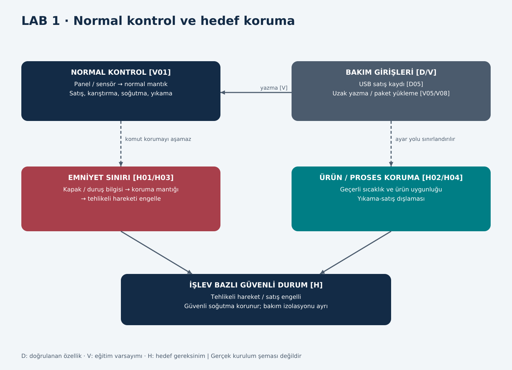

# LAB 1 | Safety Architecture

**Çıktı:** Safety Function Map · **EP 03** · T01/T02 s.2

Normal işletme kontrolü satışın gerçekleşmesini sağlar. Emniyet yolu ise kontrol yazılımı arızalansa veya yetkisiz değişse bile tanımlanmış tehlikeyi engellemelidir. Aşağıdaki şema **H hedefidir**, kurulu Arminoks devresi değildir. Ortak kabuller: V01–V04, V08–V09.

## Föy soruları ve yanıtları

### L1-Q1 | Bu makinede tehlike nedir? İnsan neyden zarar görür?

Bakım sırasında erişilebilir kabul edilen karıştırıcının beklenmedik çalışması el/kolun yakalanmasına yol açabilir (V02). Dolum ve temizlik yollarının yanlış sırada açılması temizlik maddesi veya sıcak akışla temasa neden olabilir (V03). Sıcaklık verisi bozularak uygunluğu belirsiz ürünün satılması tüketiciye biyolojik zarar yolu oluşturabilir (V04); tek bir sıcaklık sapması otomatik olarak hastalık kanıtı sayılmaz. Islak ortamda elektrik tehlikesi ayrıca tasarım incelemesi gerektirir; siberden elektrik çarpmasına kanıtsız bir zincir kurulmamıştır.

### L1-Q2 | Safety function (emniyet fonksiyonu) hangisidir?

| ID | İşlev ve tetikleyici | Güvenli tepki | Niteliği |
|---|---|---|---|
| SF-01 | Karıştırıcı erişim kapağı açılması / koruma hatası | Hareketi engelle; tam durmadan tehlikeye erişimi önle | Makine emniyeti hedefi, V02/V08 |
| SF-02 | Sıcaklık ölçümü geçersiz veya ürün uygunluğu belirsiz | Satışı engelle, kayıt/uyarı oluştur; güvenli soğutmayı koru | Ürün/gıda güvenliği hedefi, V04 |
| SF-03 | Bakım sonrası reset veya enerji geri gelmesi | Kendiliğinden başlatma yok; ayrı yerel başlatma gerekir | Makine emniyeti hedefi, V08 |
| SF-04 | Yıkama aktif, durulama/temizlik durumu belirsiz | Ürün dolumu kapalı; satış ve yıkama birbirini dışlar | Proses/gıda ve koşullu termal-kimyasal koruma, V03/V09 |

SF kodları analizde izlenebilirlik sağlar; dört işlevin de sertifikalı functional safety işlevi olduğu iddia edilmez. Acil durdurma gereksinimi gerçek tehlike değerlendirmesinde ayrıca belirlenmelidir; broşürde E-stop/Safety PLC doğrulanmamıştır.

### L1-Q3 | Safety-related control system nerede? Şemada işaretleyin.

Şemada koyu kırmızı koruma bölümü, SF-01/SF-03 için önerilen emniyetle ilgili kontrol sınırıdır: güvenilir kapak/duruş bilgisi → emniyet mantığı → tehlikeli hareketi kesen ve geri bildirimle izlenen çıkış. SF-02/SF-04 ayrı ürün/proses koruma bloğudur. Normal panel ekranı veya tek sıcaklık göstergesi kendi başına safety-related control system sayılmaz. Donanım tipi ve gereken güvenilirlik tasarım doğrulamasına bağlıdır.

### L1-Q4 | Normal PLC ile Safety PLC farkı nedir?

Normal PLC üretim sırası ve miktar gibi işletme kararlarını yürütür. Safety PLC ise uygun tasarım ve doğrulamayla emniyet işlevlerini, arızaların algılanmasını ve güvenli tepkiyi yürütmek için geliştirilmiş kontrolördür. Ayrı isim veya farklı IP adresi bağımsızlığı kanıtlamaz; sensör, mantık, çıkış, programlama yolu ve ortak nedenli arızalar birlikte incelenir. Bu makinenin kontrolör türü bilinmemektedir.

### L1-Q5 | PLr / SIL neden var? Bu fonksiyon için neden önemli?

Tehlikenin gerektirdiği risk azaltımıyla emniyet işlevinin güvenilirliğini ilişkilendirmek için kullanılır. Örneğin SF-01'in arıza halinde erişilebilir hareketi güvenle engelleyebilmesi gerekir. Ancak S/F/P girdileri, tepki süreleri ve devre bilgileri olmadığından PLr veya SIL numarası verilmez. Risk Register'daki S3, doğrudan PL e veya SIL3 anlamına gelmez.

### L1-Q6 | Safe state (güvenli durum) nedir?

Bakım erişiminde hareket durur ve yeniden başlama engellenir. Uygunluğu belirsiz sütte satış kilitlenir; güvenli soğutma mümkünse sürer ve ürün ayrılır. Temizlikte satış kapalı kalır ve tehlikeli akış kullanıcının erişebildiği bölüme verilmez. Ağ/panel kaybı satış iznini kendiliğinden oluşturamaz. Bakım için elektrik ve depolanmış enerjinin güvenli izolasyonu gerekir; işletme duruşu tam izolasyon değildir.

### L1-Q7 | Safety function hangi dijital bağımlılıklara sahip?

Kapak/reset mantığı, parametreler ve firmware (SF-01/03); sıcaklık sensörü ölçeklemesi, veri geçerliliği ve satış izni (SF-02); yıkama-satış sırası ve tamamlanma kayıtları (SF-04). Bakım aracı, yazılım yüklemesi ve hesap yetkileri bu mantığı etkileyebilen yollardır. USB'den bunlara erişim teknik olarak doğrulanmamış, V07/V08 kapsamında modellenmiştir.

### L1-Q8 | Siber müdahale hangi noktadan bu fonksiyonu bozar?

V05/V06 başlangıcında uzak servis → bakım aracı → normal kontrolör yazma yolu, V08'de normal yazılıma bağlı kapak mantığını değiştirebilir. Yerel servis hesabı sıcaklık ayarını (V04/V07); doğrulanmamış aktarım/güncelleme yolu temizlik sırasını (V03/V07/V08) etkileyebilir. Bunlar LAB2 envanterindeki G01–G06 girişlerine ve LAB3 R-01–R-04 kayıtlarına bağlanır.

## Ek sorular ve yanıtları

### L1-E1 | Her şeyi kapatmak neden her zaman güvenli değildir?

Hareketi durdurmakla soğutmayı durdurmak farklıdır. Ağ sorunu nedeniyle dolum kapatılırken soğutmanın güvenli devamı ürünün daha fazla bozulmasını önleyebilir. Tam enerji kesilmesi bakımda gerekli olabilir; bu durumda ürün korunması ayrı prosedürle ele alınır.

### L1-E2 | Panel normal sıcaklık gösteriyorsa satış yapılabilir mi?

Tek ekran bilgisi yeterli değildir. Ölçüm geçerliliği, geçmiş sapmalar, temizleme durumu ve yetkili ürün serbest bırakma kararı gerekir. Ekranın ve kararın aynı veriden beslenmesi ortak hata kaynağıdır. Kesin sıcaklık-süre eşikleri bu çalışmada uydurulmaz.

### L1-E3 | Reset neden başlatma olmamalı?

Reset yalnız hatanın giderildiğini kabul eder; kişiyi tehlikeli bölgede bırakarak hareket başlatamaz. H03 gereği enerji dönüşünde ve bakım sonrası ayrı yerel başlatma koşulu aranır.

### L1-E4 | Emniyet bağımsızlığını nasıl sınarız?

Yetkili bir laboratuvar düzeninde normal kontrolöre hareket komutu verilirken kapak açık durumu oluşturulur; hareketin engellenmesi, hata kilidi ve beklenmeyen yeniden başlama gözlenir. Uzaktan/USB yolla koruma parametresi değiştirilememesi de incelenir. Bu repo test planı verir; gerçek makinede test yapıldığı söylenmez.
