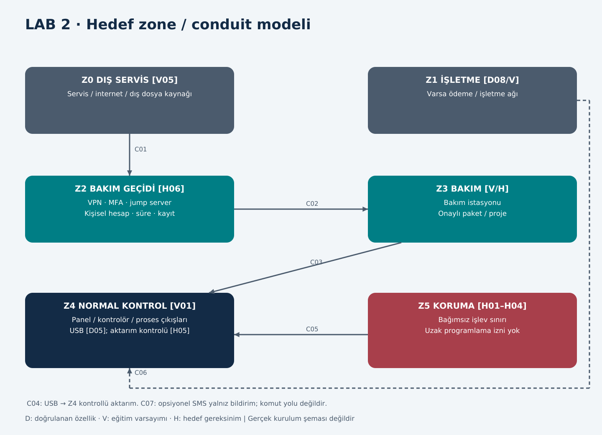

# LAB 2 - IEC 62443 Zone / Conduit

**Çıktı:** Envanter + Zone/Conduit Diagram · **EP 01 / EP 05** · T01/T02 s.3

Genel föydeki varlıklar süt otomatına uyarlanmıştır. PaketPro'ya ait robot, port 80, Wi-Fi parolası ve USB sayısı otomata aktarılmamıştır. Uzak servis ve yükleme yetkileri V05-V08 ders kabulleridir.

## Envanter: altı kategori

| ID | Kategori / varlık | Bilgi türü ve sınır |
|---|---|---|
| A01 | Donanım: dokunmatik panel | D05; model bilinmez |
| A02 | Donanım: programlanabilir kontrolör | V01; ayrı PLC olduğu doğrulanmaz |
| A03 | Donanım: karıştırıcı ve dolum pompası | D04; sürücü/valf topolojisi V01 |
| A04 | Donanım: soğutma ve sıcaklık ölçümü | D02; sensör tipi, hata tanısı V04 |
| A05 | Donanım: yıkama ve dolum akışı | D07; çalışma sırası V03/V09; valf düzeni bilinmez |
| A06 | Donanım: USB girişi | D05; port sayısı/yazma yeteneği bilinmez |
| A07 | Donanım: bakım bilgisayarı | V05/V08 |
| A08 | Donanım: uzak bakım ağ geçidi | V05; SMS modülüyle aynı cihaz değildir |
| A09 | Donanım: SMS bildirim modülü | D06 opsiyon; kurulu olduğu varsayılmaz |
| A10 | Donanım: kapak ve hareket koruma zinciri | H01/H03; gerçek donanım bilinmez |
| W01 | Yazılım: panel uygulaması | V01; sürüm bilinmez |
| W02 | Yazılım: kontrol mantığı / firmware | V01/V08; üretici ve bileşenler bilinmez |
| W03 | Yazılım: bakım/güncelleme aracı | V05/V08; ürün adı bilinmez |
| W04 | Yazılım: koruma konfigürasyonu | H01–H04; kurulu Safety PLC varsayılmaz |
| U01 | Hesap: yerel operatör | V01/V07 |
| U02 | Hesap: paylaşılan yerel servis | V07; gerçek parola bilinmez |
| U03 | Hesap: uzak servis | V05/V06; eğitimde varsayılan kimlik bilgisi |
| K01-A | Anahtar: servis erişim kimlik bilgisi | V06; gerçek anahtar/parola toplanmadı |
| K02-A | Anahtar: yazılım doğrulama güven kökü | H05; üreticide kurulu olduğu iddia edilmez |
| B01 | Dış bağlantı: uzak servis yolu | V05 |
| B02 | Dış bağlantı: çıkarılabilir USB aktarımı | D05; program yükleme V07/V08 |
| B03 | Dış bağlantı: opsiyonel SMS bildirimi | D06; komut kanalı kabul edilmez |
| F01 | Veri: sıcaklık, miktar ve alarm | D02/D05; veri yolu V01/V04 |
| F02 | Veri: satış geçmişi | D05; bütünlük kontrolü H05 |
| F03 | Veri: konfigürasyon, yazılım paketi ve yedek | V01/V08 |
| F04 | Veri: yıkama tamamlanma bilgisi | V09; ölçüm yöntemi bilinmez |

## Ders senaryosunda kullanılan beş giriş yolu

| Kapı | Envanter bağlantısı | Senaryo kullanımı |
|---|---|---|
| G01 | A08/B01/U03 uzak servis | R-01; sürekli açık varsayımı |
| G02 | A01/U02 yerel servis ekranı | R-02; fiziksel erişim |
| G03 | A06/B02 USB veri aktarımı | R-03; yükleme etkisi varsayımsal |
| G04 | A07/W03/F03 servis paketi | R-04; tedarik zinciri |
| G05 | A02/W02 bakım-programlama arayüzü | R-01/R-04 zincirinin iç adımı |

G01-G05 ders modelinin yollarıdır; beşinin de gerçek üründe doğrulandığı söylenmez. Hedef koruma konfigürasyonu W04 yeni bir giriş kapısı olarak sayılmamıştır. SMS bildirimi de komut kanalı kabul edilmez (T03, slayt 43).

## Görev A

### L2-A1 | Hangi varlıklar aynı bölgede? Bölgeleri adlandırıp gruplandırın.

| Zone | Varlıklar | Hedef sınır |
|---|---|---|
| Z0 Dış servis | Tedarikçi, internet, dış USB kaynağı | Güvenilmeyen dış sınır |
| Z1 İşletme/ödeme | İşletme ağı; varsa D08 ödeme sistemi | Kontrole doğrudan yazma yok |
| Z2 Bakım geçidi | A08 ve hedef jump server/VPN | Süreli, kayıtlı giriş |
| Z3 Bakım istasyonu | A07, W03, F03 | Onaylı aktarım/değişiklik |
| Z4 Normal kontrol | A01–A06, W01/W02, U01/U02, F01/F02/F04 | İşletme ve proses kontrolü |
| Z5 Koruma | A10/W04 ve H01–H04 işlevleri | Normal kontrolden bağımsız koruma sınırı |

Bu mantıksal bölümlendirmedir; her zone ayrı fiziksel sunucu veya ağ kartı gerektirmez. Ödeme varsa dolum talebi ile koruma izni ayrılır; ödeme onayı tek başına dolum izni olamaz.

### L2-A2 | Safety PLC'yi hangi bölgeye koydunuz, neden?

Gerçek makinede Safety PLC doğrulanmadı. İşlevsel hedefte emniyet mantığı Z5'tedir. Gerekli güvenilirlik, teknoloji ve devre seçimi yetkili tasarımla belirlenir. Z4 kontrolörünün ele geçirilmesi, Z5'in koruma kararını veya programını değiştirme hakkı vermemelidir. Aynı bakım aracı iki bölgeye sınırsız yazabiliyorsa ayrı zone etiketi tek başına yeterli değildir.

### L2-A3 | Conduit'ler nerede? Her geçişte ne kontrol edilecek?

| ID | Geçiş | Hedef kontrol / doğrulama |
|---|---|---|
| C01 | Z0 → Z2 uzak giriş | VPN, MFA, kişisel hesap; yalnız izinli bakım penceresi |
| C02 | Z2 → Z3 oturum | Jump server; görev bazlı yetki; bağlantı ve işlem kaydı |
| C03 | Z3 → Z4 bakım yazması | Belgelenmiş gerekli protokole izin; varsayılan salt okunur; yazma yerel onaylı |
| C04 | USB → Z4 | Onaylı ortam ve dosya türü; tarama; uygulama kontrolü; kaydı belirsiz dosyayı reddet |
| C05 | Z5 → tehlikeli çıkış / Z4 durum bilgisi | Koruma öncelikli; Z4 komutu korumayı geçersiz kılamaz; fiziksel test gerekir |
| C06 | Z1 → Z4 işletme/ödeme talebi | Yalnız gerekli işlem; ödeme ağından kontrolör programlama yok |
| C07 | Z4 → dış SMS altyapısı, opsiyonel | Yalnız bildirim kabulü; gelen komut destekleniyorsa yeni risk analizi |

C03'te IP/port sayıları cihaz kılavuzu olmadan uydurulmaz. İzin listesi kural tanımıdır, kurulmuş firewall kanıtı değildir. C05 mantıksal/fiziksel işlev sınırıdır; gerçek ağ bağlantısı bulunduğu iddiası değildir.

### L2-P1 | PaketPro varyantı: Açık uzak bakım modülü hangi bölgeye düşüyor; orada kalabilir mi?

V05/V06 başlangıcındaki modül dış dünya ile kontrol arasında denetimsiz köprüdür. Hedefte Z2 kontrollü geçidine alınır; Z4/Z5'e doğrudan erişim yetkisi bulunmaz. İnternet erişimi bütünüyle yoksa bu modül temel sisteme eklenmez; LAB4 tasarımı gelecekteki entegrasyon gereksinimi olarak okunur.

## Görev B: altı uzak erişim kararı

| ID / karar | Seçim | Gerekçe |
|---|---|---|
| L2-B1 Aracı | Jump server | Tek kontrollü ve kayıtlı giriş noktası |
| L2-B2 Tünel | VPN | Bakım trafiğinin korunması; tek başına yetkilendirme değildir |
| L2-B3 Kimlik | MFA | Parolanın tek başına girişe yetmemesi |
| L2-B4 Hesap | Kişisel | Sorumluluk, iptal ve izlenebilirlik |
| L2-B5 Kayıt | Tam oturum + değişiklik kaydı | Kimin neyi değiştirdiğini ilişkilendirme |
| L2-B6 Zamanlama | Varsayılan kapalı | Yerel onaylı iş emri ve otomatik süre sonu |

## Ek sorular ve yanıtları

### L2-E1 | SMS modülü internet saldırı yolu mudur?

Bildirim özelliği bunu kanıtlamaz. SIM/operatör bağlantısı, gelen komut desteği ve kontrolöre erişim yetkisi ayrıca bilinmelidir. Temel modelde bildirim çıkışıdır.

### L2-E2 | Satış verisi alan USB neden önemlidir?

Fiziksel veri sınırıdır. Gerçekten sadece dışa aktarım yapıyorsa programlama senaryosunun dayanağı kalmaz; yine dosya/veri bütünlüğü ve yetkisiz veri erişimi değerlendirilir. R-03 açıkça ek yükleme varsayımına bağlıdır.

### L2-E3 | Aynı VLAN yerine farklı VLAN yeterli koruma mıdır?

Hayır. Geçiş yetkileri, kimlik, yönetim erişimi ve fiziksel/işlevsel bağımsızlık gerekir. Z5'e uzaktan programlama yolu açık kaldığında renkli diyagram koruma sağlamaz.

### L2-E4 | Ödeme başarısı koruma koşullarını aşabilir mi?

Hayır. Satış talebi yalnız istek üretir; sıcaklık, temizlik ve bakım kilitleri ayrı izin koşullarıdır. Ödeme arızasında satış davranışı tanımlanır; koruma kilitleri kaldırılmaz.
