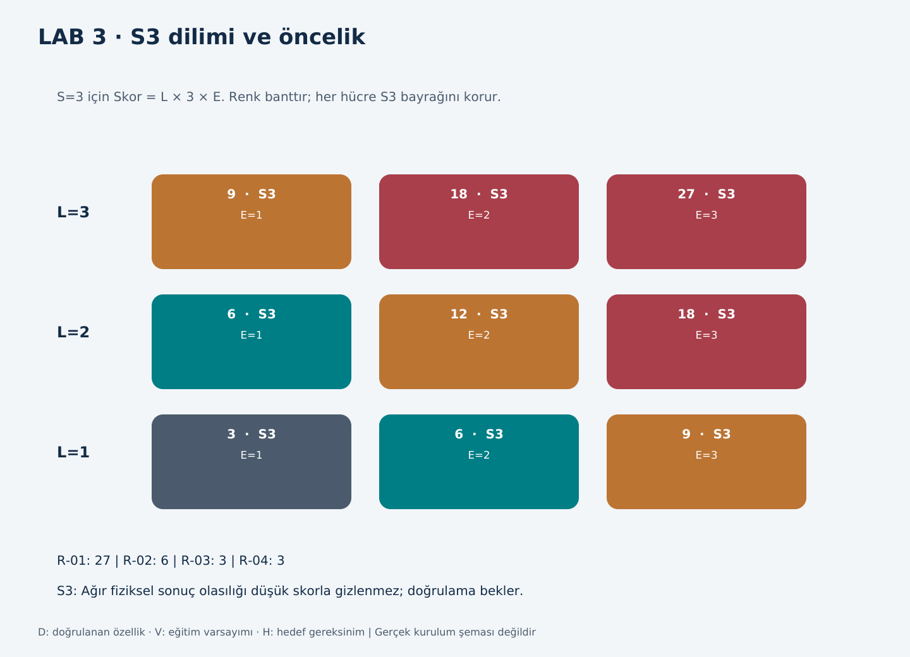

# LAB 3 - Threat & Risk Register

**Çıktı:** Risk Register | **EP 04** | T01/T02, PDF s.4; T03, slayt 23-33 ve 43-46

Değerlendirme: 26.10.2026, Batuhan Yaşar Özkan. Makine: Arminoks süt otomatı eğitim modeli v1.1. Aşağıdaki puanlar V01-V09 kabullerine dayanır; gerçek makinede tespit edilmiş açıklık veya olay değildir. Hedef önlemler başlangıçta uygulanmış sayılmaz.

## L x S x E ölçeği

| Puan | L: istismar kolaylığı | S: fiziksel sonuç | E: yolun dışarıya açıklığı |
|---|---|---|---|
| 1 | Zor; özel bilgi/fiziksel erişim veya zincir gerekir | Yaralanma yok | Yalnız fiziksel erişim |
| 2 | Orta; zayıf/paylaşılan kimlik bilgisi gerekir | Hafif, geri dönüşlü yaralanma | İşletme ağı veya süreli dış erişim |
| 3 | Kolay; doğrulama yok/varsayılan veya hazır araç | Ağır/kalıcı yaralanma, ölüm, yangın/patlama | İnternet veya sürekli açık dış yol |

Skor = L x S x E. Bantlar: 18-27 Kritik, 9-17 Yüksek, 4-8 Orta, 1-3 Düşük. **E, insan maruziyeti değildir. S3 olan kayıt düşük skorda da ayrıca izlenir.**

## Senaryolar

### R-01 | Fırsatçı dış: uzaktan kapak korumasının değiştirilmesi

Fırsatçı dış saldırgan G01 uzak servis yolundan G05 kontrolör yazma arayüzüne ulaşır (V05/V06). V08'de normal yazılıma bağlı kapak/reset mantığını değiştirir; SF-01/SF-03 bozulur. V02'de bakım yapan kişi karıştırıcıya erişirken beklenmedik hareket ağır el/kol yaralanmasına yol açabilir. Bağlantılar: Z0-Z2-Z3-Z4; C01/C02/C03.

L3: Ders başlangıcında varsayılan kimlik bilgisi ve geniş yazma yetkisi kabul edilmiştir. S3: Erişilebilir karıştırıcıya yakalanma ağır yaralanma doğurabilir. E3: Bu senaryodaki uzak yol sürekli açıktır.

### R-02 | Meraklı içeriden: sıcaklık ve satış koşulunun değiştirilmesi

Meraklı içeriden kişi G02 yerel servis hesabıyla sıcaklık/satış koşulunu değiştirir (V04/V07). SF-02 bozulur; uygunsuz muhafaza koşullarındaki ürünün satılması, gerekli bozulma/bulaşma koşulları da oluşursa tüketicide ciddi hastalığa yol açabilir. Tek sıcaklık sapması hastalık kanıtı değildir. Bağlantılar: Z4; A01/A04/U02/F01.

L2: Paylaşılan servis kimlik bilgisine erişmek gerekir. S3: Koşullu en kötü sonuç ciddi biyolojik zarardır. E1: Buradaki giriş yalnız makine başındaki servis ekranıdır.

### R-03 | Tedarik zinciri: yıkama tamamlanma koşulunun bozulması

Tedarik zinciri saldırganı G04 servis paketini değiştirir; paket G03 USB yoluyla yüklenebilir kabul edilir (V07). Değişen kontrol mantığı yıkama bitmeden tamamlandı bilgisi üretir (V03/V09). SF-04 bozulur; temizlik yetersiz kaldığı halde satış açılır. Uygun bulaşma/çoğalma koşullarında ürün tüketicide ciddi biyolojik zarara yol açabilir. Kimyasal veya sıcak yıkama varsayılmaz. Bağlantılar: Z0-Z3/Z4; C04; A05/A06/W02/W03/F03/F04.

L1: Servis paketinin değiştirilmesi ve fiziksel yükleme zinciri gerekir. S3: Yetersiz hijyenin ürüne yansıması koşulunda ciddi hastalık mümkün kabul edilmiştir. E1: Makineye son geçiş fiziksel USB aktarımıdır.

### R-04 | Hedefli: yeniden başlatma engelinin kaldırılması

Hedefli saldırgan G04 bakım projesini değiştirir; proje yerel serviste G05 üzerinden yüklenir (V08). SF-03 devre dışı kalır. V02'de kişi bakım bölgesindeyken enerji geri gelirse karıştırıcı beklenmedik başlayabilir ve ağır yaralanma oluşabilir. Bağlantılar: Z3-Z4; C03; A07/W03/F03/A02/A03.

L1: Makineye uygun proje bilgisi, değişiklik ve yerel aktarım gerekir. S3: Beklenmedik hareket R-01 ile aynı ağır yaralanmaya uzanabilir. E1: Bu senaryoda son erişim yerel bakım bağlantısıdır.

## Risk Register

| ID | L | S | E | Skor / bant | S3 | Öncelik |
|---|---|---|---|---|---|---|
| R-01 | 3 | 3 | 3 | 27 Kritik | Evet | 1 |
| R-02 | 2 | 3 | 1 | 6 Orta | Evet | 2 |
| R-03 | 1 | 3 | 1 | 3 Düşük | Evet | 3 |
| R-04 | 1 | 3 | 1 | 3 Düşük | Evet | 4 |

R-03/R-04 aynı öncelik grubundadır; sıra idarîdir. Dört kayıt da S3 listesinde açık tutulur. R-02/R-03'ün biyolojik sonuçları ürün ve süreç verisiyle ayrıca doğrulanmalıdır; puanlar gerçek hastalık veya bulaşma bulgusu değildir.

## Önlemler, sorumlular ve hedef puanlar

| ID | Önerilen önlem | A / R önerisi | Eğitim hedef tarihi | Hedef L/S/E |
|---|---|---|---|---|
| R-01 | Kontrolsüz uzak yazmayı kapat; H01/H03/H06/H07 | İşletmeci / OT-servis | 25.11.2026 | 1/3/2 = 6 |
| R-02 | Servis yetkilerini ayır; H02 | İşletmeci / gıda sorumlusu-OT | 24.01.2027 | 1/3/1 = 3 |
| R-03 | Yıkama-satış kilidi ve güvenilir paket; H04/H05 | İşletmeci / servis-gıda sorumlusu | 24.01.2027 | 1/3/1 = 3 |
| R-04 | Yeniden başlama engeli ve proje bütünlüğü; H03/H05 | İşletmeci / servis-emniyet uzmanı | 24.01.2027 | 1/3/1 = 3 |

Gerçek mevcut kontrol kanıtı yoktur. Hedef puanlar, erişim önlemleri doğrulanırsa beklenen eğitim değerleridir; ölçülmüş artık risk değildir. Aynı puan korunsa da fiziksel zincirin kesilmesi testle ayrıca kaydedilir. S3 otomatik S1 yapılmaz. Kanıt bağlantıları: LAB1 işlevleri, LAB2 kapıları ve KT01-KT07 test planı; EP04.

A, hesap veren; R, uygulayan rol önerisidir. Tarihler T03'teki 30/90 günlük öneriden hesaplanmıştır; gerçek görev/ödev teslim tarihi değildir. Yakın fiziksel tehlikede bu süreler beklenmez.

## Föy soruları

### L3-Q1 | En yüksek öncelikli senaryonuz hangisi? Neden?

R-01. Ders modelindeki kolay erişilir ve sürekli açık servis yolu, koruma mantığını değiştirerek bakım yapan kişide ağır yaralanmaya uzanabilir.

### L3-Q2 | S=3 olup skoru düşük kalan senaryo var mı? Nasıl görünür kılacaksınız?

R-03/R-04 skor 3'tür ama S3'tür. Ayrı S3 listesinde sahip, hedef tarih ve doğrulama kanıtıyla izlenir; önlem veya yetkili yazılı kabul olmadan kapatılmaz.

## LAB3 tartışma soruları

### L3-T1 | Aynı kapıyı iki farklı profil kullanırsa skor değişir mi?

Yalnız profil adı değiştiği için değişmez. Erişim koşulu, gereken beceri veya etkilenen işlev değişiyorsa ayrı gerekçeyle farklı kayıt açılır.

### L3-T2 | Skoru 27 ama S1 olan senaryo mu, skoru 3 olan S3 mü önce?

S1 için en yüksek skor 3 x 1 x 3 = 9'dur; sorudaki 27 değeri ölçekle uyumsuzdur. Geçerli 9/S1 ve 3/S3 karşılaştırmasında ciddi fiziksel sonuç içeren S3 gözden kaçırılmaz.

### L3-T3 | Emniyete dokunmayan siber senaryo Register'a girmeli mi?

Üretim/veri etkisi için S1 olarak tutulabilir; emniyet bulgusu diye sunulmaz. Fiziksel zarar zinciri varsa ayrıca açıklanmalıdır.

### L3-T4 | Tedarikçinin güvenli beyanına ne kadar güvenirsiniz; hangi kanıt gerekir?

Beyan tek başına yeterli değildir. Sürüm, devre/ağ yapısı, yazma yetkileri ve ilgili test kayıtlarıyla desteklenmelidir. Bu ödevde firmadan belge istenmez; eksik bilgi açık bırakılır.

### L3-T5 | Register ne zaman tekrar puanlanmalı?

Yeni açık, yazılım/ağ değişikliği, bakım, olay veya bir varsayımın yanlışlanması durumunda; ayrıca planlı gözden geçirmede yeniden değerlendirilir.

## Ek sorular

### L3-E1 | İnternet bağlantısı hiç yoksa sonuç ne olur?

R-01'in uzak yolu temel kurulumdan çıkarılır. Yerel ekran, USB ve bakım yolları ilgili kabuller geçerliyse ayrıca değerlendirilir.

### L3-E2 | Yıkama yöntemi bilinmiyorsa risk nasıl yazılmalı?

Kimyasal, sıcaklık veya özel sensör varlığı uydurulmaz. R-03 yalnız otomatik yıkamanın kontrol koşuluna bağlı bir senaryodur; yıkama yeterliliği hakkında saha sonucu vermez.

### L3-E3 | Önlem sonrası skor düşmüyorsa önlem işe yaramaz mı?

Hayır. L1/E1 ölçeğin tabanıdır; daha aşağı sayı yoktur. Zincirin kesildiğini gösteren test ve kalan belirsizlik ayrıca kaydedilir.

### L3-E4 | En çok tartışılabilecek puan hangisi?

R-02/R-03'ün S3 puanıdır. Ürün, süre ve bulaşma koşulları bilinmediğinden ciddi biyolojik sonuç koşullu kabul edilmiştir; gıda sorumlusu incelemesi gerekir.
