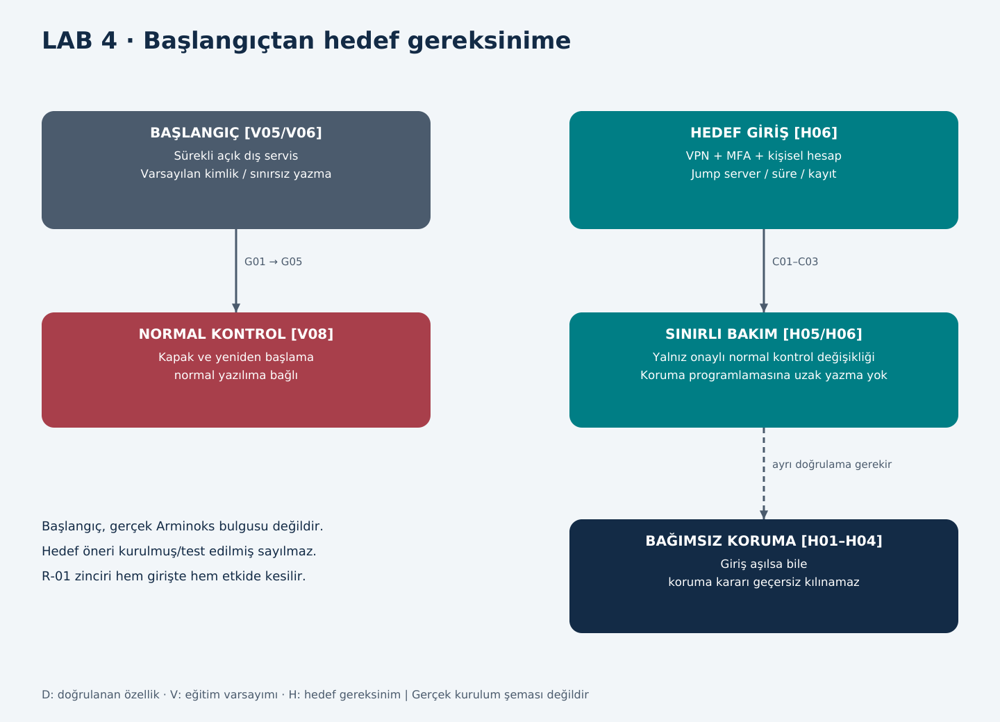

# LAB 4 - Secure Remote Access

**Çıktı:** Secure Architecture · **EP 02 / EP 06** · T01/T02 s.5

## L4-A | Görev A: Mevcut → hedef

Başlangıç V05/V06/V08 ders senaryosudur. Üreticinin gerçek kurulumunda internete açık servis veya varsayılan parola bulunduğu söylenmez.

### Başlangıç modeli

Dış servis sürekli açık G01 yoluyla bakım aracına erişebilir; varsayılan kimlik bilgisi ve kısıtsız G05 yazması kabul edilir. Panel/kontrol yazılımında bulunan kapak, yeniden başlama ve proses izinleri değiştirilebilir. Kişisel hesap, oturum kaydı ve değişiklik onayı kanıtı yoktur. USB'nin program yükleme etkisi ayrıca V07/V08'e bağlıdır. Hedefte bu varsayımların açık bırakılmaması amaçlanır.

### Beş tasarım ilkesi ve tünel kontrolü

| İlke | Otomata uygulanışı | İz / kabul ölçütü |
|---|---|---|
| 1. Kontrollü ara nokta | Yalnız Z2 jump server üzerinden bakım | C01/C02 dışındaki yollar reddedilir |
| 2. Kişisel hesap / asgarî yetki | Operatör, servis ve yetkili değişiklik rolleri ayrılır | U02 paylaşımı kaldırılır; her işlem hesapla eşleşir |
| 3. MFA | Uzak girişte ikinci faktör | Yalnız parola ile giriş reddedilir |
| 4. Varsayılan kapalı / süreli | İş emri, yerel onay, bakım penceresi | Süre bitince oturum ve geçiş yetkisi kapanır |
| 5. Oturum / değişiklik kaydı | Oturum, dosya/ayar ve onay kaydı birlikte | Değişen sürüm ve sorumlu izlenebilir |

VPN, uzak taşıma yolunu koruyan ek zorunlu kabulümüzdür; asgarî yetki ve emniyet bağımsızlığı yerine geçmez. Bu tablo kurulmuş ürün listesi değil, hedef tasarım gereksinimidir. Gerçek cihaz desteklemiyorsa uygun haricî geçit veya farklı servis yöntemi değerlendirilir.

## Görev B: Functional safety köprüsü

### L4-B1 | Saldırgan bütün önlemlere rağmen içeri girerse emniyet fonksiyonu etkilenir mi? Neden?

Başlangıç modelinde evet: V08'de normal kontrol yazılımındaki kapak/yeniden başlama koşulları G05 üzerinden değiştirilebilir. Hedefte C01–C03'ün aşılması SF-01/SF-03'ü değiştirmeye yeterli olmamalıdır. Bunun için yalnız ağ ayrımı değil, koruma mantığı/ayarları/çıkışlarının ve yerel değişiklik yolunun bağımsızlığı gerekir. SF-02/SF-04 için de normal satış komutu koruma iznini aşamamalıdır. Hedef gerçekleşmiş veya doğrulanmış sayılmaz.

### L4-B2 | Emniyetin kontrol sisteminden ve uzak bakım yolundan bağımsızlığı için gereksinimi yazın.

| ID | Üründen bağımsız gereksinim | Nasıl doğrulanır? |
|---|---|---|
| H01 | Kapak açık veya koruma durumu geçersizken normal kontrolör/uzak komut karıştırıcıda tehlikeli hareket oluşturamamalı; gerekli duruş sağlanmadan erişim olmamalı | KT01; en kötü komut ve hata durumunda duruş/erişim ölçümü |
| H02 | Geçersiz sıcaklık veya ürün uygunluğu belirsizken panel/ödeme/uzak komut ürün satışını açamamalı | KT02; hata ve geçmiş sapma denemeleri |
| H03 | Enerji, haberleşme veya reset dönüşü kendiliğinden tehlikeli hareket başlatmamalı | KT03; ayrı yerel başlatma kontrolü |
| H04 | Satış ile yıkama birbirini dışlamalı; yıkama tamamlandığı doğrulanmadan satışa geçilememeli | KT04; durum geçiş ve satış izni testi |
| H05 | Koruma ayarları ve güvenilir yazılım yalnız yetkili yerel süreçle değişebilmeli; paket kaynağı, bütünlük, önceki sürüm ve onay kaydı korunmalı | KT05; yetkisiz/bozuk paket reddi ve sürüm izi |
| H06 | Uzak erişim yerel onaylı süreyle ve kişisel kimlikle sınırlanmalı; koruma programlama yoluna yazma vermemeli | KT06; hesap/rota/yetki testleri |
| H07 | Ağ/servis kaybı güvenli davranışı bozmamalı; dolum kilidi ve koruma sürerken güvenli soğutma ihtiyacı ayrıca karşılanmalı | KT07; bağlantı kaybı testi |

PaketPro'nun ışık perdesi sorusu H01/H03 erişim ve yeniden başlama korumasına uyarlanmıştır. Gereksinimler bir marka seçmez; hangi ürünle sağlanacağı tasarım kararıdır.

## Süreli bakım prosedürü

1. İşletmeci iş emrini, amacı, kişiyi ve süreyi onaylar; ürün/satış durumu belirlenir.
2. Mevcut proje, ayarlar ve loglar yedeklenir; kullanılan sürüm/hash kaydedilir.
3. Yerel sorumlu C01/C02'yi süreli açar. VPN+MFA ile kişisel hesap kullanılır.
4. Önce salt okunur tanılama yapılır. Gerekiyorsa yazma ayrı onay ve güvenli bakım koşuluyla açılır; Z5 programlama uzak oturuma verilmez.
5. Değişiklik sonrası H01–H07 ile ilgili doğrulamalar ve ürün uygunluğu kontrolleri tamamlanır.
6. Süre sonunda bağlantı/yetki kapatılır; oturum, dosya ve test kayıtları iş emrine bağlanır. Satış/üretim yalnız yerel serbest bırakmayla açılır.

## Ek sorular ve yanıtları

### L4-E1 | Bakımcı ekranı görebiliyorsa program da yükleyebilir mi?

Görme yetkisi yazma yetkisi değildir. Hedef, ekran/teşhis erişimi ile kontrolör ve koruma konfigürasyonu değişikliklerini ayrı yetkilendirmektir. Gerçek araç ayrımı desteklemiyorsa uzak oturuma genel yönetici yetkisi verilmez.

### L4-E2 | Bağlantı kesilince ne olur?

Geçici bakım yetkisi kapanır; koruma yerel çalışmayı sürdürür. Devam eden değişiklik yarım kaldıysa satış ve tehlikeli hareket açılmaz; güvenilir sürüm ve test sonucu olmadan uzaktan yeniden başlatma yapılmaz. Soğutma davranışı H07 kapsamında belirlenir.

### L4-E3 | Ayrı Safety PLC varsa tamamen güvende miyiz?

Hayır. Ortak bakım hesabı veya programlama yolu iki sistemi de değiştirebilir. Sensör/çıkış paylaşımı, güç kaynağı, yazılım değiştirme yetkileri ve konfigürasyon bağımsızlığı da değerlendirilir. Bu makinede ayrı Safety PLC varlığı zaten doğrulanmamıştır.

### L4-E4 | Öncelikli risk zinciri nerede kırılır?

R-01 için C01'de süreli kimlikli giriş, C03'te sınırlı yazma ve son halkada H01/H03 bağımsız koruma gerekir. İlk katman giriş ihtimalini azaltır; son katman giriş olsa da fiziksel sonucu engellemeyi hedefler. Sonucun kanıtı diyagram değil, KT01/KT03/KT06 testleridir.
