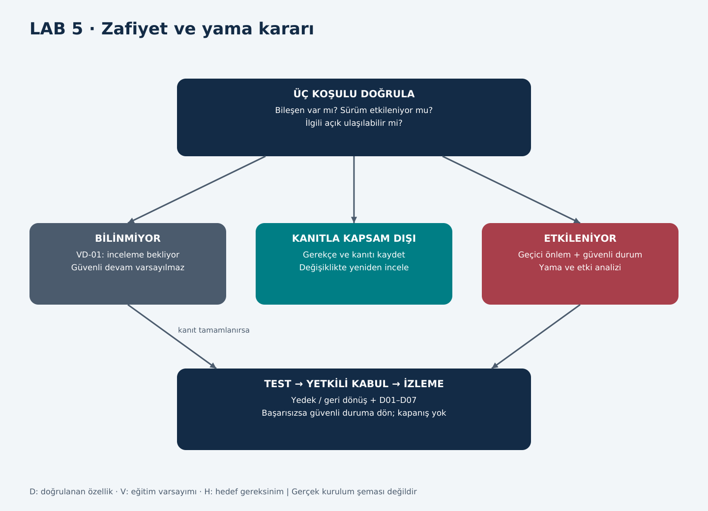

# LAB 5 | SBOM / CVE / Patch

**Çıktı:** Vulnerability Decision (VD-01) · **EP 09 / EP 10 / EP 11** · T01/T02 s.6

## Girdi ve kararın statüsü

Föyde verilen **Component X, sürüm 2.4, CVE-XXXX-XXXX, CVSS 9.8 ve mevcut yama** bir eğitim girdisidir (V10). CVE-XXXX-XXXX gerçek CVE numarası değildir; bu makinenin bu bileşeni kullandığı bilinmez. CVSS 9.8, insan zararının veya Arminoks'taki gerçek riskin puanı değildir. Temsili bileşen kontrol yazılımında bulunursa H01–H04'e etkisi incelenecek kabul edilmiştir.

**VD-01 sonuç:** Etkilenme durumu **belirsiz / doğrulama bekliyor**. Gerçek ürüne etkilendi veya etkilenmedi kararı verilmez; yama uygulanmış sayılmaz. Bu belirsizliğe rağmen geçici erişim sınırları ve güvenli işletme kararı tanımlanabilir.

## Föy soruları ve yanıtları

### L5-Q1 | Bu CVE sizi gerçekten etkiliyor mu? Üç şartı kontrol edin.

| Şart | Bu ödevde bilinen | Karar için gereken |
|---|---|---|
| Bileşen var mı? | Kontrolör/yazılım bileşen listesi yok | Gerçek BOM/SBOM ve ürün modeli |
| Sürüm etkileniyor mu? | 2.4 yalnız föyün girdisi | Gerçek sürüm + resmî üretici güvenlik duyurusu |
| Açık ulaşılabilir mi? | Protokol/özellik bilinmez; uzak yol V05 | Aktif özellik, yetki, rota ve erişim koşulları |

Üçü de kanıtla doğrulanırsa ilgili açıklık için etkilenme kaydı açılır. Bir koşulun karşılanmadığı kanıtlanırsa gerekçeli kapsam dışı/ulaşılamaz kararı verilebilir; ağ değişince tekrar incelenir. Bir koşul bile bilinmiyorsa güvenli değil/etkilenmez diye kesin sonuç verilmez. Bu karar akışı risk değerlendirmesiyle birlikte kullanılır.

### L5-Q2 | Üretimi hemen durdurur musunuz? Neden / neden değil?

Sadece temsili CVSS sayısı yüzünden bütün otomatın enerjisi kesilmez. Önce mevcut emniyet ve ürün koşulları değerlendirilir. Koruma bütünlüğü, kontrol mantığı veya ürün uygunluğu güvenilir biçimde doğrulanamıyorsa satış ve ilgili tehlikeli hareket güvenli duruma alınır; güvenli soğutma sürdürülür ve ürün ayrılır. Doğrulanmış etkilenmeme ya da kabul edilmiş telafi kontrolü varsa yetkili işletmeci gerekçeli devam kararı verebilir. Gerçek cihaz değerlendirmesi yapılmadığı için bu çalışma işletmeye devam izni vermez.

### L5-Q3 | Yamayı doğrudan mı uygularsınız, önce test mi? Nerede test?

Önce gerçek ürün/sürüm için resmî paket, bütünlük ve bağımlılıklar doğrulanır. Yedek, geri dönüş ve donanım uyumu belirlenir. Hedefle aynı cihaz/firmware/IO düzenini temsil eden izole test düzeneğinde denenir; simülasyon ancak destekleyici kanıttır. Otomatın kendisinde müşteri varken denenmez. Temsilî düzenek yoksa güvenli, planlı bakım ve yetkili devreye alma koşulları oluşturulmadan canlıya yama yüklenmez.

### L5-Q4 | Yama safety validation'ı etkiliyor mu? Nasıl anlarsınız?

Sürüm notu ve değişen bileşenin SF-01–SF-04 bağımlılıkları karşılaştırılır. Kapak/duruş, reset, zamanlama, giriş ölçekleme, çıkış varsayılanı ve haberleşme kaybı davranışı etkileniyorsa ilgili emniyet doğrulaması yeniden gerekir. Bileşen kapsamı belirsizse etkisi yok kabul edilmez. D01–D07 testleri, değişiklik etkisine göre uzman tarafından seçilir; gıda güvenliği kontrolleri ayrıca yürütülür. Yalnız normal dolumun çalışması yeterli değildir.

### L5-Q5 | Yama mümkün değilse telafi edici önlem ne olur?

Uzak yazma kapatılır, gereksiz servis/özellik devre dışı bırakılır, C03 asgarî izin listesi uygulanır, servis yetkileri daraltılır, USB aktarımı kontrol edilir ve değişiklikler izlenir. Koruma mantığının bütünlüğü doğrulanır; geri yükleme hazırlığı yapılır. Açığın exploit koşulu bilinmeden firewall'ın mutlaka yeterli olduğu söylenmez. Kalan fiziksel risk kabul edilemiyorsa satış/ilgili hareket devre dışı tutulur. Telafi kontrolünün sahibi, süresi ve yeniden inceleme koşulu yazılır.

## EP09: Yazılım / SBOM hazırlık taslağı

Bu tablo **gerçek SBOM değildir**. Ürün bileşenleri, sürüm, tedarikçi, tanımlayıcı, bağımlılık ve lisans bilinmeden tamamlanmış SBOM üretilemez. CycloneDX/SPDX biçimine uygunluk veya gerçek VEX kaydı iddia edilmez.

| Kimlik | Bileşen / kapsam | Sürüm / tedarikçi | Kanıt durumu |
|---|---|---|---|
| SW-01 | Panel uygulaması W01 | Bilinmiyor | V01; envanter doğrulaması gerekli |
| SW-02 | Kontrolör firmware / mantık W02 | Bilinmiyor | V01/V08 |
| SW-03 | Bakım aracı W03 | Bilinmiyor | V05/V08 |
| SW-04 | Ağ geçidi yazılımı A08 | Bilinmiyor | V05; gerçek kurulumda olmayabilir |
| SW-X | Föyün Component X kütüphanesi | 2.4; tedarikçi belirtilmemiş | V10; yalnız eğitim girdisi |

Gerçek kayıtta ayrıca hash, ürün/seri numarası, bağımlılık, kaynak, edinim tarihi, etkilenen özellik ve duyuru bağlantısı bulunmalıdır. Bu alanlara rastgele değer yazılmaz.

## EP10: Zafiyet karar kaydı

| Alan | VD-01 |
|---|---|
| Makine / analiz sürümü | Arminoks süt otomatı eğitim modeli v1.0 |
| Kayıt tarihi / hazırlayan | 26.10.2026 / Batuhan Yaşar Özkan |
| Girdi | Component X 2.4; temsili CVE; CVSS 9.8; yama mevcut (V10) |
| Etkilenme | Belirsiz: bileşen, sürüm, ulaşılabilirlik doğrulanmadı |
| İlgili riskler | Etki eşleştirmesine göre R-01–R-04; otomatik olarak hepsi etkilenmiş sayılmaz |
| Geçici karar | Kontrolsüz erişimi sınırla; bütünlük/ürün güveni yoksa güvenli duruma al |
| A / R önerisi | İşletmeci / OT-servis; ürün etkisinde gıda sorumlusu |
| Açık ihtiyaç | Gerçek ürün/SBOM, duyuru, desteklenen yama, test ve geri dönüş kanıtı |
| Statü | Taslak; inceleme bekliyor; kapatılmadı |

## EP11: Yama ve geri dönüş kayıt taslağı

| Aşama | Kaydedilecek kanıt | Bu çalışmadaki durum |
|---|---|---|
| Öncesi | Cihaz/sürüm, yedek hash'i, ayarlar, onay | Gerçek cihaz bilgisi yok |
| Paket | Resmî kaynak, imza/hash, sürüm notu, bağımlılık | Temsili yama; paket indirilmedi |
| Test | Düzenek tanımı, D01–D07 sonuçları, ürün kontrolü | Planlandı; uygulanmadı |
| Devreye alma | İş emri, saat, sorumlu, yeni sürüm | Yapılmadı |
| Geri dönüş | Eski sürüme destekli dönüş, veri/ayar uyumu, tekrar test | Yeteneği bilinmiyor; otomatik vaat edilmez |
| Kapanış | Onaylı test, izleme ve Register güncellemesi | Açık |

## Ek sorular ve yanıtları

### L5-E1 | Gerçek CVE bulmadan LAB5 tamamlanabilir mi?

Evet. Föy açıkça temsili kayıt veriyor; beklenen çıktı bu kayıt üzerinden gerekçeli karar akışıdır. Ödevi güçlendirmek adına ilgisiz gerçek CVE'yi cihaza yakıştırmak doğruluğu azaltır.

### L5-E2 | Hash doğruysa paket güvenilir midir?

Hash yalnız karşılaştırılan referans güvenilir ise bütünlük kanıtına katkı verir. Saldırganın paketle birlikte verdiği hash kaynak doğrulaması değildir. Üreticinin resmî dağıtımı, imza/güven kökü ve doğru ürün-sürüm uyumu ayrı kontrol edilir.

### L5-E3 | Geri dönüş desteklenmiyorsa ne yaparız?

Deneme yanılma ile canlıya geçilmez. Uyumlu yedek cihaz, destekli kurtarma veya başka planlı güvenli servis yöntemi gerekir. Böyle bir yol yoksa telafi kontrolleri ve risk kabulü yeniden değerlendirilir; güvenli devam kanıtlanamıyorsa işletme açılmaz.

### L5-E4 | Kapanış için hangi somut sonuç gerekir?

Gerçek etkilenen varlık tanımlanmış, yama veya telafi kontrolü doğrulanmış, ilgili SF testleri ve ürün uygunluğu onaylanmış, sürüm/log/yedek kayıtları tutulmuş ve risk sahibi kararı kaydetmiş olmalıdır. Dosyanın hazırlanması veya paketin yüklenmesi tek başına kapanış değildir.
