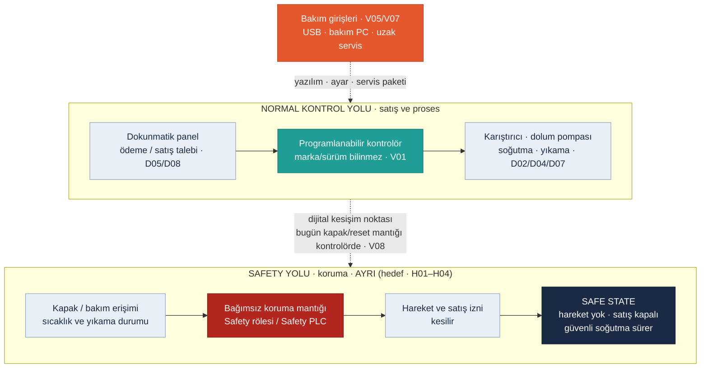

<!-- foy lab="1" title="Safety Architecture" output="Safety Function Map" -->
<!-- pdf:skip-start -->
# Lab 1 · Safety Architecture

**Makine:** Arminoks Süt Otomatı · **Çıktı:** Safety Function Map → Evidence Pack **EP 03 Safety Functions** · 📄 [PDF föyü](../pdf/lab1-safety-architecture.pdf)

| Ad Soyad | Öğrenci No | Grup | Tarih |
|---|---|---|---|
| Batuhan Yaşar Özkan | 230541050 | Gündüz-B | 06.11.2026 |
<!-- pdf:skip-end -->

> **Kavram:** Emniyet fonksiyonu, insanı koruyan fonksiyondur ve **ayrı bir safety yolunda** yaşar (E-stop → Safety PLC → STO). Gerekli güvenilirliği (PLr/SIL) riskle orantılıdır — ve bu güvenilirlik, **dijital bir konfigürasyona** bağlıdır.

> **Arminoks bağlamı:** Süt soğutulur (0–4 °C), programlanabilir karıştırıcıyla karıştırılır, kendinden emişli pompayla dolum yapılır ve her dolumdan sonra dolum ünitesi otomatik yıkanır (D02, D04, D07). Broşürde E-stop veya Safety PLC bilgisi yoktur. Bu yüzden şemanın safety yolu **doğrulanmış devre değil, hedef koruma modelidir** (V01–V04, V08–V09). Burada iki tür zarar var: **bakımcının eli** (karıştırıcı, pompa) ve **tüketicinin sağlığı** (uygunsuz sıcaklık veya yıkama sonrası satış).

## Safety Function Map

Kırmızı kutu ve alttaki yol, **safety-related control system (SRCS)** hedefidir. Turuncu kutu dışarıdan erişilebilen dijital kapıdır. Kesikli oklar, siber müdahalenin koruma zincirine dokunabildiği yerleri gösterir.

## Görev — sırayla cevaplayın

### 1. Bu makinede tehlike nedir? İnsan neyden zarar görür?

- **Karıştırıcı ve pompa (bakım sırasında):** Tank kapağı açıkken dönen karıştırıcıya el/kol kaptırma; pompa ve valf bölgesinde sıkışma. Ağır yaralanma olabilir (V02).
- **Beklenmedik yeniden çalışma:** Enerji dönüşü veya reset sonrasında, kişi içerideyken hareket başlaması (V08).
- **Tüketici sağlığı:** Sıcaklığı uygun olmayan ya da yıkaması tamamlanmamış dolum hattından süt satılması, uygun koşullarda ciddi biyolojik zarar doğurabilir (D02, D07, V09).
- **İkincil:** 220 V besleme (D01), ıslak zeminde kayma, yıkama suyu.

En riskli an, **bakımcının tank veya dolum ünitesine müdahale ettiği ve makinenin uzaktan (V05) ya da otomatik sırayla yeniden çalışabileceği** andır.

### 2. Safety function (emniyet fonksiyonu) hangisidir?

| ID | İşlev | Güvenli tepki | Tür |
|---|---|---|---|
| SF-01 | Karıştırıcıya erişim koruması | Kapak/erişim açıkken hareket yok; duruş olmadan erişim yok | Makine emniyeti |
| SF-02 | Sıcaklık ve ürün uygunluğu kilidi | Ölçüm geçersiz veya sapmışsa satış kapalı | Gıda koruması |
| SF-03 | Beklenmedik yeniden başlamayı önleme | Reset veya enerji dönüşü hareket başlatmaz | Makine emniyeti |
| SF-04 | Yıkama–satış ayrımı | Yıkama bitmeden veya durum belirsizken satış yok | Gıda koruması |

SF kodları LAB'lar arasında iz sürmek içindir. Dördünün de **sertifikalı emniyet fonksiyonu** olduğu söylenmez. SF-02/SF-04 ürün koruma kilitleridir, makine emniyeti standardının kapsamı ayrıca değerlendirilir.

### 3. Safety-related control system nerede? Şemada işaretleyin.

Şemadaki **kırmızı kutu ve SAFETY YOLU** (kapak/erişim girişi → bağımsız koruma mantığı → hareket ve satış izninin kesilmesi) SF-01/SF-03 için SRCS hedefidir. Bugünkü varsayımda (V08) bu mantık normal kontrolörün yazılımında duruyor. Bu yüzden şemada **dijital kesişim noktası** olarak işaretlendi.

### 4. Normal PLC ile Safety PLC farkı nedir?

| | Normal PLC / kontrolör | Safety PLC / safety rölesi |
|---|---|---|
| Amaç | Satış, dolum, karıştırma, yıkama sırası | İnsanı koruyan fonksiyon ve güvenli arıza tepkisi |
| Arıza davranışı | Tanımlı değil; donabilir, yanlış çıkış verebilir | Kendini sınar, arızada güvenli duruma geçer |
| Yapı | Tek kanal | Çift kanal, çapraz kontrol, sertifikalı yazılım bloğu |
| Değiştirme | Bakım aracıyla kolayca | Yetkili, imzalı/parola korumalı, yeniden doğrulama ister |

Ayrı cihaz ya da ayrı IP adresi **tek başına bağımsızlık sağlamaz**. Aynı bakım aracı ve hesap ikisine de yazabiliyorsa koruma gene dijital olarak aşılabilir.

### 5. PLr / SIL neden var? Bu fonksiyon için neden önemli?

PLr (ISO 13849-1) ve SIL (IEC 62061), bir emniyet fonksiyonunun **ne kadar güvenilir olması gerektiğini** riskle orantılı biçimde belirler: yaralanma ne kadar ağır, tehlikeye ne sıklıkla girilir, kaçınma mümkün mü? SF-01'de bakımcı tanka elini sokacağı için arızada da korumanın sürmesi gerekir. Devre, kullanım sıklığı ve tepki süresi bilinmediği için **PLr/SIL değeri atanmadı**. LAB3'teki S=3 puanı bir PLr karşılığı değildir.

### 6. Safe state (güvenli durum) nedir?

- **Hareket:** Karıştırıcı ve pompa durmuş, **yeniden başlaması engellenmiş**.
- **Satış:** Satış ve dolum kapalı; panel nedenini gösterir.
- **Soğutma:** Güvenli soğutma **sürer**. Her şeyi kapatmak sütü bozar ve ikinci bir gıda riski yaratır.
- **Bakım:** Kapak kapatıldı diye hareket başlamaz; ayrı yerel başlatma gerekir. Bakımda enerji izolasyonu (kilitle-etiketle) ayrıca uygulanır.

### 7. Safety function hangi dijital bağımlılıklara sahip?

- Kontrolör programındaki **kapak / reset mantığı** (SF-01, SF-03 · V08)
- **Sıcaklık ölçümü**, alarm eşiği ve satış izni ayarı (SF-02 · V04)
- **Yıkama sırası** ve "tamamlandı" bilgisi (SF-04 · V09)
- Panel uygulaması ve bakım aracı (W01, W03)
- Yükleme yolları: **USB**, bakım bilgisayarı, varsa uzak servis (V05, V07)

### 8. Siber müdahale hangi noktadan bu fonksiyonu bozar?

**Dijital kesişim noktası:** Kontrolöre program veya ayar yazılabilen yol. Bu yol uzak servis, yerel servis ekranı, USB ile yüklenen servis paketi ya da bakım bilgisayarı olabilir. Buradan kapak/reset mantığı değiştirilirse SF-01/SF-03, sıcaklık eşiği değiştirilirse SF-02, yıkama sırası değiştirilirse SF-04 bozulur. Ders modelindeki en riskli yol **sürekli açık uzak servis → bakım arayüzü → kontrolör** zinciridir (LAB2 G01/G05, LAB3 R-01).

## Ek sorularımız

### 9. Hata durumunda her şeyi kapatmak neden bu makinede güvenli değildir? `EK SORU`

Tehlikeli hareketi ve satışı durdurmak ile **soğutmayı** durdurmak farklı kararlardır. Soğutma da kesilirse tanktaki süt birkaç saat içinde uygunsuz hâle gelebilir ve bu ikinci bir gıda riskidir. Doğru güvenli durum **fonksiyon bazlıdır**: hareket ve satış kesilir, soğutma güvenle sürer (H07).

### 10. Panel normal sıcaklık gösteriyorsa satış yapılabilir mi? `EK SORU`

Tek bir ekran değeri yetmez. Ekran, değiştirilmiş yazılımda doğru görünürken ölçüm bozuk olabilir. Satış izni için ölçümün **geçerli** olması (sensör hatası yok), geçmişte eşik dışına çıkılmaması ve yıkamanın tamamlanmış olması birlikte aranır. Kabul eşikleri gıda sorumlusunca belirlenir; burada değer uydurulmadı.

### 11. Reset neden "başlat" anlamına gelmemeli? `EK SORU`

Reset, koruma hatasının giderildiğini **onaylar**; makineyi çalıştırmaz. Reset'e basıldığında karıştırıcı dönmeye başlarsa, kapağı yeni kapatan ya da hâlâ içeride olan kişi yaralanabilir. Hareket için güvenli koşullar sağlandıktan sonra ayrı bir yerel başlatma gerekir (SF-03).

### 12. Emniyet bağımsızlığını nasıl sınarız? `EK SORU`

Yetkili bir test düzeneğinde: (1) kapak açıkken normal kontrolörden hareket komutu verilir, hareket **olmamalı**; (2) koruma ayarı uzaktan değiştirilmeye çalışılır, **reddedilmeli**; (3) enerji kesilip geri verilir, hareket **kendiliğinden başlamamalı**. Bunlar LAB4'teki KT01/KT03/KT06 testleridir; bu çalışmada uygulanmadı.

## Varsayımlar

V01–V04 ve V08–V09 kullanıldı ([Makine profili](00-makine-profili.md)). Kapak/erişim korumasının gerçek tipi, kontrolör modeli ve ayrı bir Safety PLC bulunup bulunmadığı sahada doğrulanmalıdır.

> Bu föyün çıktısı **Safety Function Map** → Evidence Pack **EP 03 Safety Functions** başlığına oturur. Durum: **Taslak**.
