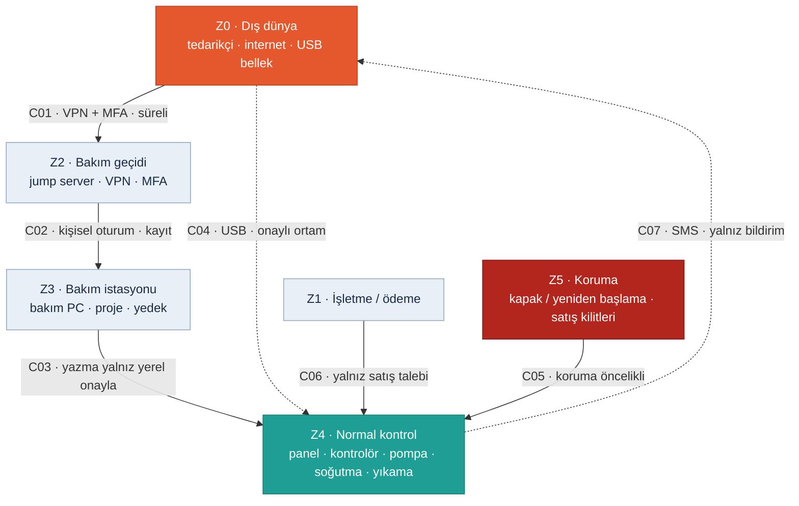

<!-- foy lab="2" title="IEC 62443 Mini Workshop" output="Zone / Conduit Diagram" -->
<!-- pdf:skip-start -->
# Lab 2 · IEC 62443 Mini Workshop

**Makine:** Arminoks Süt Otomatı · **Çıktı:** Zone / Conduit Diagram → Evidence Pack **EP 01 Asset Inventory · EP 05 Zone & Conduit** · 📄 [PDF föyü](../pdf/lab2-iec62443-zone-conduit.pdf)

| Ad Soyad | Öğrenci No | Grup | Tarih |
|---|---|---|---|
| Batuhan Yaşar Özkan | 230541050 | Gündüz-B | 06.11.2026 |
<!-- pdf:skip-end -->

> **Kavram:** **Zone** = benzer kritiklikteki cihazları bir bölgeye topla. **Conduit** = bölgeler arası her geçişe kontrollü bir kapı. 62443'ün maddesini ezberlemiyoruz — mantığını uyguluyoruz.

> **Arminoks bağlamı:** Föydeki genel varlık listesi (PLC · HMI · Robot kontrolörü · Safety PLC · SCADA istemcisi · Mühendislik istasyonu · Uzak servis erişimi · Ofis ağı) süt otomatına uyarlandı. Otomatta robot ve SCADA yok. Onların yerine karıştırıcı/pompa, soğutma, yıkama, USB ve opsiyonel SMS modülü var. Uzak servis ve yükleme yetkileri ders kabulüdür (V05–V08).

## Görev A — varlıkları bölgelere ayırın

### Varlık listesi — Arminoks envanteri (EP 01)

| ID | Kategori / varlık | Bilgi türü ve sınır |
|---|---|---|
| A01 | Donanım: dokunmatik panel (HMI) | D05; model bilinmiyor |
| A02 | Donanım: programlanabilir kontrolör (PLC) | V01; ayrı PLC olduğu doğrulanmadı |
| A03 | Donanım: karıştırıcı ve dolum pompası | D04; sürücü/valf yapısı V01 |
| A04 | Donanım: soğutma ve sıcaklık ölçümü | D02; sensör tipi V04 |
| A05 | Donanım: yıkama ve dolum akışı | D07; çalışma sırası V03/V09 |
| A06 | Donanım: USB girişi | D05; yazma yeteneği bilinmiyor |
| A07 | Donanım: bakım bilgisayarı (mühendislik istasyonu) | V05/V08 |
| A08 | Donanım: uzak bakım ağ geçidi | V05; SMS modülüyle aynı cihaz değil |
| A09 | Donanım: SMS bildirim modülü | D06 opsiyon; kurulu varsayılmadı |
| A10 | Donanım: kapak ve hareket koruma zinciri (Safety PLC hedefi) | H01/H03; gerçek donanım bilinmiyor |
| W01–W04 | Yazılım: panel uygulaması · kontrol programı · bakım aracı · koruma konfigürasyonu | V01/V05/V08; sürümler bilinmiyor |
| U01–U03 | Hesap: yerel operatör · paylaşılan yerel servis · uzak servis | V06/V07 |
| AK01, AK02 | Anahtar: servis kimlik bilgisi · yazılım doğrulama güven kökü | V06; H05 (kurulu iddia edilmez) |
| B01–B03 | Dış bağlantı: uzak servis · USB aktarımı · opsiyonel SMS | V05; D05; D06 |
| F01–F04 | Veri akışı: sıcaklık/alarm · satış geçmişi · konfigürasyon/yedek · yıkama tamamlandı bilgisi | D02/D05; V08; V09 |

### 1. Hangi varlıklar aynı bölgede? Bölgeleri adlandırıp gruplandırın.

| Zone | Varlıklar | Kritiklik / hedef sınır |
|---|---|---|
| Z0 Dış dünya | Tedarikçi, internet, dışarıdan gelen USB bellek, SMS altyapısı; B01–B03'ün dış uçları | Güvenilmeyen |
| Z1 İşletme / ödeme | İşletme ağı; varsa ödeme sistemi (D08) | Kontrolöre doğrudan yazamaz |
| Z2 Bakım geçidi | A08, U03, AK01 + hedefteki jump server / VPN | Süreli ve kayıtlı giriş |
| Z3 Bakım istasyonu | A07, W03, F03 | Yalnız onaylı değişiklik |
| Z4 Normal kontrol | A01–A06, A09 (SMS modülü, opsiyon), W01/W02, U01/U02, F01/F02/F04 | Satış ve proses |
| Z5 Koruma | A10, W04, AK02; H01–H04 işlevleri | Normal kontrolden bağımsız |

Bu **mantıksal** bölümlendirmedir; her zone ayrı bir fiziksel cihaz gerektirmez.

**Giriş kapıları (LAB3 senaryolarında kullanılır):**

| Kapı | Yol | Envanter / conduit |
|---|---|---|
| G01 | Uzak servis girişi (sürekli açık kabul edilir) | A08, B01, U03 · C01 |
| G02 | Yerel servis ekranı (paylaşılan hesap) | A01, U02 · Z4 içi |
| G03 | USB veri aktarımı | A06, B02 · C04 |
| G04 | Servis paketi / bakım projesi (tedarik zinciri) | A07, W03, F03 · Z3 |
| G05 | Kontrolör bakım-programlama arayüzü | A02, W02 · C03 |

G01–G05 ders modelinin yollarıdır (V05–V08); gerçek üründe doğrulanmadı.

### 2. Safety PLC'yi hangi bölgeye koydunuz — neden?

**Z5 Koruma** bölgesine, normal kontrolden (Z4) ayrı. Neden: Z4'teki kontrolör ele geçirilse bile Z5'in koruma kararı ve programı **değiştirilememeli**. Gerçek makinede Safety PLC bulunduğu doğrulanmadı; Z5 bir hedef sınırdır. Aynı bakım aracı iki bölgeye de sınırsız yazabiliyorsa ayrı bir zone etiketi tek başına koruma sağlamaz.

### 3. Bölgeler arası geçişler (conduit) nerede? Her geçişte ne kontrol edilecek?

| ID | Geçiş | Kontrol |
|---|---|---|
| C01 | Z0 → Z2 uzak giriş | VPN, MFA, kişisel hesap; yalnız onaylı bakım penceresinde açık |
| C02 | Z2 → Z3 oturum | Jump server; görev bazlı yetki; oturum ve işlem kaydı |
| C03 | Z3 → Z4 bakım yazması | Varsayılan salt okunur; yazma yalnız yerel onayla; izinli protokol listesi |
| C04 | USB → Z4 | Onaylı ortam ve dosya türü; tarama; imzası/kaynağı belirsiz dosya reddedilir |
| C05 | Z5 → Z4 / tehlikeli çıkış | Koruma önceliklidir; Z4 komutu korumayı geçersiz kılamaz |
| C06 | Z1 → Z4 ödeme / satış talebi | Yalnız satış isteği; ödeme ağından programlama yok |
| C07 | Z4 → SMS altyapısı (opsiyon) | Yalnız dışarı bildirim; gelen komut destekleniyorsa yeni risk analizi |

Port ve IP numaraları cihaz kılavuzu olmadan uydurulmadı. Tablo kural tanımıdır; kurulmuş bir firewall'un kanıtı değildir.

## Görev B — uzak erişim kararı (6 satır)

| Karar | Seçenekler | Seçiminiz + nedeni |
|---|---|---|
| Aracı? | Doğrudan / Jump server | **Jump server** — tek, kontrollü ve kayıtlı giriş noktası; bakımcı kontrolöre doğrudan ulaşmaz |
| Tünel? | Açık / VPN | **VPN** — bakım trafiği şifreli ve yalnız tanımlı uca gider; tek başına yetki vermez |
| Kimlik? | Parola / MFA | **MFA** — çalınan veya varsayılan parola (V06) tek başına içeri sokmaz |
| Hesap? | Paylaşılan / Kişisel | **Kişisel** — kimin ne yaptığı bilinir; ayrılan kişinin erişimi tek tek kapatılır |
| Kayıt? | Yok / Tam oturum kaydı | **Tam oturum kaydı** + değişiklik kaydı — kim, ne zaman, neyi değiştirdi |
| Zamanlama? | Sürekli açık / Varsayılan kapalı | **Varsayılan kapalı** — iş emriyle yerelden açılır, süre bitince kendiliğinden kapanır |

## Ek sorularımız

### 4. Bağlantı noktası açık bir uzak bakım modülü hangi bölgeye düşer; orada kalabilir mi? `EK SORU`

Bugünkü kabulde (V05/V06) modül, dış dünya ile kontrolör arasında **denetimsiz bir köprüdür**; fiilen Z0 ile Z4'ü birleştirir. Orada kalamaz. Hedefte Z2 bakım geçidine taşınır ve Z4/Z5'e doğrudan erişim hakkı kalmaz. Otomatta internet hiç yoksa modül hiç eklenmez. (PaketPro föyündeki varyant sorusunun uyarlamasıdır.)

### 5. SMS modülü bir internet saldırı yolu mudur? `EK SORU`

Bildirim özelliği bunu tek başına kanıtlamaz. SIM/operatör bağlantısı, modülün **gelen komut** kabul edip etmediği ve kontrolöre yazma yetkisi ayrıca bilinmelidir. Temel modelde C07 yalnız dışarı bildirim yapan tek yönlü bir geçiştir. Komut alıyorsa yeni bir conduit olarak yeniden analiz edilir.

### 6. Ödeme başarılı olduysa koruma koşulları aşılabilir mi? `EK SORU`

Hayır. Ödeme yalnız **satış isteği** üretir (C06). Sıcaklık, yıkama ve bakım kilitleri ayrı izin koşullarıdır. Ödeme alınmış ama sıcaklık geçersizse satış yapılmaz, ödeme iade akışına gider. Koruma kilidi ticari sebeple kaldırılmaz.

### 7. Z4 ve Z5'i ayrı VLAN'a koymak yeterli koruma mıdır? `EK SORU`

Hayır. VLAN yalnız ağ trafiğini ayırır. Aynı bakım hesabı ya da aynı programlama aracı iki bölgeye de yazabiliyorsa koruma yine değiştirilebilir. Gerekli olan geçiş yetkisi, kimlik, yönetim erişimi ve koruma mantığının **işlevsel bağımsızlığıdır** (LAB4 H05/H06). Renkli bir diyagram tek başına koruma sağlamaz.

## Varsayımlar

V01 ve V05–V09 kullanıldı ([Makine profili](00-makine-profili.md)). Gerçek ağ yapısı, uzak erişim yolunun bulunup bulunmadığı ve USB'nin yazma yeteneği sahada doğrulanmalıdır.

> Bu föyün çıktısı **Zone / Conduit Diagram** → Evidence Pack **EP 05 Zone & Conduit** başlığına oturur; varlık listesi **EP 01 Asset Inventory**'ye girer. Durum: **Taslak**.
