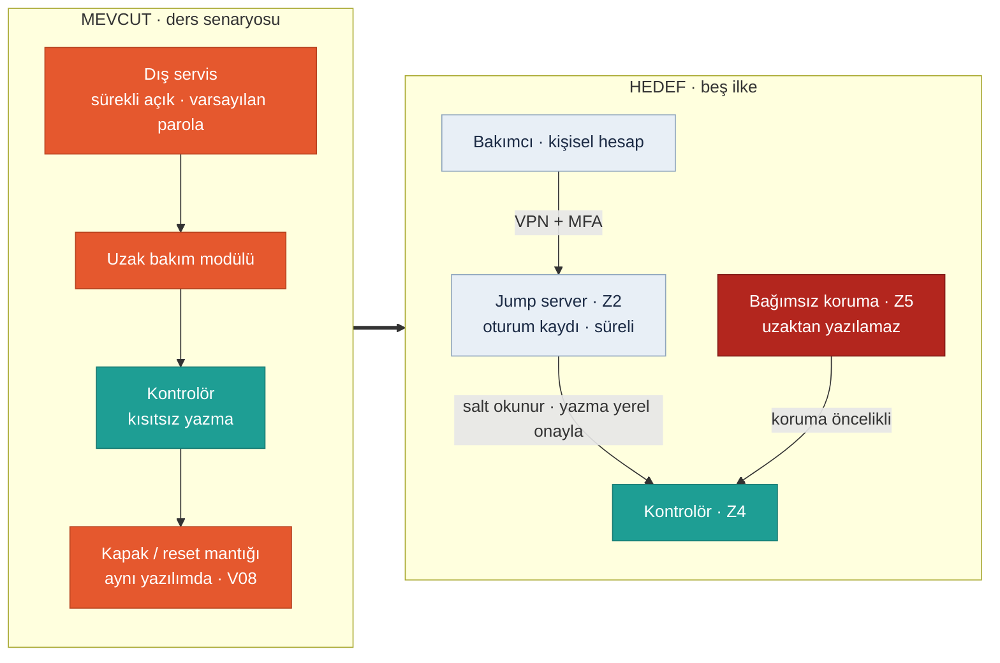

<!-- foy lab="4" title="Secure Remote Access" output="Secure Architecture" -->
<!-- pdf:skip-start -->
# Lab 4 · Secure Remote Access

**Makine:** Arminoks Süt Otomatı · **Çıktı:** Secure Architecture → Evidence Pack **EP 02 Network Architecture · EP 06 Remote Access Procedure** · 📄 [PDF föyü](../pdf/lab4-secure-remote-access.pdf)

| Ad Soyad | Öğrenci No | Grup | Tarih |
|---|---|---|---|
| Batuhan Yaşar Özkan | 230541050 | Gündüz-B | 06.11.2026 |
<!-- pdf:skip-end -->

> **Kavram:** İki katman, ikisi de şart: **erişim güvenliği** (girişi zorlaştır: ara nokta, VPN, MFA, kişisel hesap, kayıt, varsayılan kapalı) + **emniyet bağımsızlığı** (girse bile insan korunur).

> **Arminoks bağlamı:** "Mevcut" taraf ders senaryosudur (V05/V06/V08): sürekli açık uzak servis, varsayılan parola, kontrolöre kısıtsız yazma. Üreticinin gerçek kurulumunda bunların bulunduğu **söylenmez**. "Hedef" taraf, LAB2 Görev B'deki altı kararın ve LAB1'deki ayrı safety yolunun birleşimidir.

## Görev A — mevcut → hedef

**Mevcut:** Dış servis, sürekli açık yoldan ve varsayılan parolayla bakım modülüne, oradan kontrolöre yazabiliyor. Kapak ve yeniden başlama koşulları aynı yazılımda olduğu için **tek bir oturum koruma mantığını değiştirebilir**. Kişisel hesap, oturum kaydı ve değişiklik onayı yok.

| İlke | Hedefte otomata uygulanışı | Kabul ölçütü |
|---|---|---|
| 1 · Ara nokta | Yalnız Z2 jump server üzerinden bakım | C01/C02 dışındaki yollar reddedilir |
| 2 · VPN | Bakım trafiği yalnız tanımlı tünelden | Tünel dışı bağlantı yok; VPN yetki vermez |
| 3 · MFA + kişisel hesap | Operatör, servis, yetkili değişiklik rolleri ayrı | Paylaşılan U02 kalkar; her işlem bir kişiye bağlı |
| 4 · Kayıt | Oturum, dosya/ayar değişikliği, onay birlikte | Değişen sürüm ve sorumlu izlenebilir |
| 5 · Varsayılan kapalı | İş emri + yerel onay + bakım penceresi | Süre bitince oturum ve yetki kapanır |

Tablo kurulmuş ürün listesi değil, hedef tasarım gereksinimidir. Cihaz bunları desteklemiyorsa harici bir geçit veya farklı servis yöntemi seçilir.

## Görev B — functional safety köprüsü

### 1. Saldırgan tüm önlemlere rağmen içeri girerse: emniyet fonksiyonu etkilenir mi? Neden?

**Mevcut yapıda (ders kabulü) evet.** Kapak ve yeniden başlama mantığı normal kontrol yazılımında (V08); kontrolöre yazabilen herkes SF-01/SF-03'ü kapatabilir. **Hedefte hayır olmalı:** C01–C03 aşılsa bile koruma mantığı, ayarları ve çıkışları ayrı (Z5) olduğu ve uzaktan yazılamadığı için karıştırıcı kapak açıkken dönemez. Aynı şey satış için de geçerli: normal satış komutu SF-02/SF-04 kilitlerini aşamaz. Bu bir hedeftir, doğrulanmış durum değildir.

### 2. Emniyet fonksiyonunun kontrol sisteminden bağımsız çalışması için GEREKSİNİMİ yazın (çözümü değil).

| ID | Gereksinim | Doğrulama |
|---|---|---|
| H01 | Kapak açık veya koruma durumu geçersizken, normal kontrolör ya da uzak komut karıştırıcıda tehlikeli hareket **oluşturamamalıdır** | KT01 |
| H02 | Sıcaklık ölçümü geçersiz veya ürün uygunluğu belirsizken panel, ödeme ya da uzak komut satışı **açamamalıdır** | KT02 |
| H03 | Enerji, haberleşme veya reset dönüşü kendiliğinden tehlikeli hareket **başlatmamalıdır** | KT03 |
| H04 | Satış ile yıkama birbirini dışlamalı; yıkama tamamlandığı doğrulanmadan satışa geçilememelidir | KT04 |
| H05 | Koruma ayarları yalnız yetkili yerel süreçle değişebilmeli; paket kaynağı, bütünlüğü ve önceki sürüm korunmalıdır | KT05 |
| H06 | Uzak erişim kişisel kimlik ve yerel onaylı süreyle sınırlı olmalı, koruma programlama yoluna **yazma vermemelidir** | KT06 |
| H07 | Ağ veya servis kaybı koruma davranışını bozmamalı; satış kilidi sürerken güvenli soğutma devam etmelidir | KT07 |

> **Tarafsızlık notu:** Bu föy çözüm tasarlatmaz; gereksinimi tanımlatır. Tasarım kararı firmanızındır. Gereksinimler marka seçmez; Safety PLC, safety rölesi ya da başka bir çözümle karşılanabilir.

### Doğrulama planı (KT01–KT07)

| Test | Gereksinim | Kontrol ve beklenen sonuç |
|---|---|---|
| KT01 | H01 / SF-01 | Kapak açık/hatalıyken hareket komutu → hareket olmaz; duruş-erişim süresi ölçülür |
| KT02 | H02 / SF-02 | Geçersiz sıcaklık ve ürün durumu → satış kapalı, uyarı var, soğutma sürer |
| KT03 | H03 / SF-03 | Reset, enerji ve haberleşme dönüşü → ayrı yerel başlatma olmadan hareket yok |
| KT04 | H04 / SF-04 | Yıkama sürerken veya durum belirsizken satış talebi → reddedilir |
| KT05 | H05 | Bozuk/yanlış paket veya yetkisiz ayar → reddedilir, kayıt ve geri dönüş yolu var |
| KT06 | H06 | Yanlış rol, eksik MFA, süre sonu → giriş/yazma reddedilir, geçici erişim kapanır |
| KT07 | H07 | Ağ/panel kaybı → koruma sürer, satış kendiliğinden açılmaz, soğutma güvenli |

Testler gerçek makinede yapılmadı; yetkili bir düzenekte, kimseyi tehlikeye sokmadan uygulanmaları önerilir.

### Süreli bakım prosedürü (EP 06)

1. İşletmeci iş emrini onaylar: amaç, kişi, süre; satış durumu belirlenir.
2. Mevcut proje, ayar ve kayıtlar yedeklenir; sürüm ve özet değeri (hash) yazılır.
3. Yerel sorumlu C01/C02'yi süreli açar; bakımcı VPN + MFA + kişisel hesapla girer.
4. Önce salt okunur tanılama. Yazma ayrı onay ve güvenli bakım koşuluyla açılır; Z5 hiçbir zaman uzak oturuma açılmaz.
5. Değişiklikten sonra ilgili KT testleri ve ürün uygunluğu kontrolleri yapılır.
6. Süre bitince erişim kapanır; oturum, dosya ve test kayıtları iş emrine bağlanır. Satış yalnız yerel onayla açılır.

## Ek sorularımız

### 3. Bakımcı ekranı görebiliyorsa program da yükleyebilmeli mi? `EK SORU`

Hayır. Görme yetkisi yazma yetkisi değildir. Uzak tanılama (ekran, alarm, sıcaklık geçmişi) ile kontrolör ve koruma ayarı değiştirme **ayrı roller** olarak yetkilendirilir. Araç bu ayrımı desteklemiyorsa uzak oturuma genel yönetici yetkisi verilmez.

### 4. Bakım sırasında bağlantı koparsa ne olur? `EK SORU`

Geçici yetki kendiliğinden kapanır; koruma yerelde çalışmayı sürdürür. Yarım kalmış bir değişiklik varsa satış ve tehlikeli hareket açılmaz; bilinen iyi sürüm ve test sonucu olmadan uzaktan yeniden başlatma yapılmaz. Soğutma H07'ye göre sürer.

### 5. Ayrı bir Safety PLC varsa tamamen güvende miyiz? `EK SORU`

Hayır. Ortak bakım hesabı veya ortak programlama aracı iki sistemi birden değiştirebilir. Sensör ve çıkış paylaşımı, ortak güç kaynağı ve konfigürasyon yetkileri de incelenir. Bağımsızlık bir cihaz alımı değil, **değiştirme yetkisinin** ayrılmasıdır (H05/H06).

### 6. Öncelikli risk zinciri (R-01) nerede kırılır? `EK SORU`

Üç yerde: **C01**'de süreli ve kimlikli giriş (girişi zorlaştırır), **C03**'te salt okunur varsayılan (yazmayı zorlaştırır), son halkada **H01/H03** bağımsız koruma (girse bile karıştırıcı dönmez). İlk iki katman olasılığı (L, E) düşürür; son katman insanı korur. Kanıtı diyagram değil, KT01/KT03/KT06 testleridir.

## Varsayımlar

V05, V06 ve V08 kullanıldı ([Makine profili](00-makine-profili.md)). Otomatın gerçekte uzak erişime sahip olup olmadığı ve kontrolörün rol ayrımını destekleyip desteklemediği doğrulanmalıdır.

> Bu föyün çıktısı **Secure Architecture** → Evidence Pack **EP 02 Network Architecture + EP 06 Remote Access Procedure** başlığına oturur. Durum: **Taslak**.
