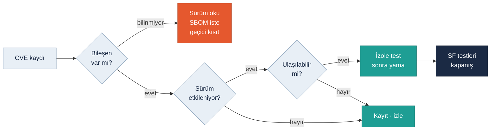

<!-- foy lab="5" title="SBOM / CVE / Patch" output="Vulnerability Decision" -->
<!-- pdf:skip-start -->
# Lab 5 · SBOM / CVE / Patch

**Makine:** Arminoks Süt Otomatı · **Çıktı:** Vulnerability Decision → Evidence Pack **EP 09 SBOM · EP 10 Vulnerability Records · EP 11 Patch/Update Records** · 📄 [PDF föyü](../pdf/lab5-sbom-cve-patch.pdf)

| Ad Soyad | Öğrenci No | Grup | Tarih |
|---|---|---|---|
| Batuhan Yaşar Özkan | 230541050 | Gündüz-B | 06.11.2026 |
<!-- pdf:skip-end -->

> **Kavram:** **SBOM** = yazılım malzeme listesi · **CVE** = açığın kayıt no'su · **CVSS** = ciddiyet (0–10). Bir CVE sizi etkiler mi? Üç şart: **bileşen var, sürüm etkileniyor, açık ulaşılabilir**.

> **Arminoks bağlamı:** Föyün verdiği kayıt temsilidir (V10) ve aşağıda föydeki gibi kullanıldı. Ayrıca otomatın panel yazılımı için gerçek CVE adayları ayrı bir araştırmada incelendi (sayfa sonundaki kutu). Kurulu sürümler okunamadığı için **iki durumda da karar "etkilenme belirsiz, inceleme gerekli"** çıkıyor.

## Verilen zafiyet kaydı

| Bileşen | Sürüm | CVE | Önem | Yama |
|---|---|---|---|---|
| Component X (PLC firmware kütüphanesi) | 2.4 | CVE-XXXX-XXXX | Critical (CVSS 9.8) | Mevcut |

## Görev — karar akışı

### 1. Bu CVE sizi gerçekten etkiliyor mu? (üç şartı kontrol edin)

| Şart | Bilinen | Gereken bilgi |
|---|---|---|
| Bileşen var mı? | Gerçek bileşen listesi yok | Kontrolör modeli ve üreticiden SBOM |
| Sürüm etkileniyor mu? | 2.4 yalnız föy girdisi | Kurulu sürüm (sahada okunur) + resmî duyuru |
| Açık ulaşılabilir mi? | Protokol ve erişim yolu bilinmiyor | Açığın kullandığı servis LAB2'deki bir conduit'ten geçiyor mu? |

**Karar (VD-01): etkilenme belirsiz.** Bilinmeyen bilgi "etkilenmiyoruz" sonucuna çevrilmez. CVSS 9.8, açığın genel ciddiyetidir; bu otomattaki riski tek başına belirlemez.

### 2. Üretimi hemen durdurur musunuz? Neden / neden değil?

Yalnız CVSS puanı yüzünden **otomatın tüm enerjisi kesilmez**; aksi hâlde soğutma da durur ve tanktaki süt bozulur. Bunun yerine: uzak erişim kapatılır (C01), USB yüklemesi askıya alınır (C04), koruma ve ürün uygunluğu kontrol edilir. Koruma bütünlüğünden şüphe varsa satış ve tehlikeli hareket güvenli duruma alınır, soğutma sürer. Devam kararını yetkili işletmeci verir.

### 3. Yamayı doğrudan mı uygularsınız, önce test mi? Nerede test?

**Önce test.** Yamanın doğru ürün ve sürüme ait resmî paket olduğu (kaynak, imza/hash) doğrulanır; mevcut proje ve ayarlar yedeklenir. Test, aynı kontrolör ve panel sürümüyle kurulmuş **izole bir düzenekte** yapılır: dolum, yıkama, sıcaklık alarmı ve koruma davranışı denenir. Düzenek yoksa yama planlı bir bakım penceresinde, satış kapalı ve geri dönüş planı hazırken uygulanır; canlı satış sırasında asla.

### 4. Bu yama bir safety validation etkiliyor mu? Nasıl anlarsınız?

Sürüm notu ve değişen bileşenin **SF-01–SF-04 ile ilişkisi** incelenir. Kapak/reset mantığı, zamanlama, sıcaklık ölçümü, yıkama sırası ya da çıkış davranışı değişiyorsa ilgili doğrulama tekrarlanır (KT01–KT04). "Dolum çalışıyor" demek yeterli değildir; korumanın hâlâ devreye girdiği test edilmelidir.

### 5. Yama mümkün değilse compensating control (telafi edici önlem) ne olur?

- Gereksiz servisler ve uzak yazma kapatılır; erişim LAB2 Görev B kararlarına çekilir.
- Servis hesabı kişiselleştirilir, USB'den yükleme engellenir.
- Açığın ulaşılabildiği conduit (ör. C01) tamamen kapatılır veya izlenir.
- Önlemin bu açığa yettiği test edilir, süreli izleme kararı yazılır.
- Kalan fiziksel risk kabul edilemiyorsa satış ve ilgili hareket kapalı tutulur.

### Kayıtlar (EP 09 · 10 · 11)

| Kayıt | İçerik | Durum |
|---|---|---|
| EP 09 SBOM taslağı | W01 panel uygulaması · W02 kontrol programı · W03 bakım aracı · W04 koruma konfigürasyonu · A08 uzak geçit yazılımı · Component X 2.4 (temsili) | Sürümler bilinmiyor; gerçek SBOM değil |
| EP 10 VD-01 | 06.11.2026 · Component X 2.4 · temsili CVE · CVSS 9.8 · etkilenme belirsiz · geçici kısıt: C01/C04 kapalı | Açık |
| EP 11 Yama kaydı | Öncesi (sürüm, yedek, onay) → paket (kaynak, hash) → test (düzenek, KT sonuçları) → kurulum (iş emri) → geri dönüş → kapanış | Plan var; uygulanmadı |

Bilinmeyen alanlara örnek değer yazılmadı. Tam SBOM için tedarikçi, kurulu sürüm, bağımlılıklar ve lisans bilgileri gerekir.

> **Gerçek kayıtlarla ek inceleme (06.11.2026):** Panelin LS eXP20 ailesinden olabileceği görsel olarak saptandı. Bu aileye ait yazılımlar için gerçek CVE adayları, etkilenen sürüm aralıkları ve kanıtları [yazılım/CVE envanterinde](../raporlar/Arminoks_Yazilim_Surum_CVE_Envanteri.xlsx) ve [teknik raporda](../raporlar/Arminoks_Siber_Guvenlik_On_Degerlendirme_Raporu.pdf) yer alıyor. Kurulu sürüm okunmadığı için bunlar **koşullu adaydır**; üç şartın ilk ikisi doğrulanmadan etkilenme iddia edilmez.

## Ek sorularımız

### 6. Raporlardaki gerçek CVE adayları bu föyün kararını değiştirir mi? `EK SORU`

Karar mantığını değiştirmez, girdisini değiştirir. Temsili kayıtta da gerçek adaylarda da ilk eksik aynıdır: **kurulu sürüm**. Sahada panel ve kontrolör sürümü okunduğunda her aday için üç şart yeniden işletilir; etkilenen çıkarsa VD-02 kaydı açılır. İlgisiz bir CVE'yi makineye aitmiş gibi eklemek doğru olmaz.

### 7. Hash değeri doğruysa paket güvenilir midir? `EK SORU`

Ancak hash **güvenilir bir kaynaktaki** referansla karşılaştırıldıysa. Paketle aynı yerden indirilen hash, değiştirilmiş paketi de "doğru" gösterebilir. Üretici imzası, doğru ürün/sürüm uyumu ve indirildiği kanal da kontrol edilir (H05).

### 8. Kontrolör eski sürüme geri dönüşü desteklemiyorsa ne yapılır? `EK SORU`

Geri dönüş yoksa canlı otomatta deneme yapılmaz. Önce yedek cihaz, üretici destekli kurtarma veya tam proje yedeğinden geri yükleme yolu hazırlanır. Bu sağlanamıyorsa yama ertelenir; telafi önlemleri (soru 5) sürer ve karar kayda geçer.

### 9. Bir zafiyet kaydı hangi kanıtla kapatılır? `EK SORU`

Dört kanıt birlikte: etkilenen varlık ve sürüm belli; yama veya telafi önlemi uygulandı; ilgili SF testleri (KT01–KT04) geçti ve yeni sürüm kaydedildi; sorumlu kişi kapanışı imzaladı. Bunlardan biri eksikse kayıt "açık" kalır.

## Varsayımlar

V01, V05, V08 ve V10 kullanıldı ([Makine profili](00-makine-profili.md)). Kontrolör ve panel sürümleri sahada okunmalı, üreticiden SBOM istenmelidir.

> Bu föyün çıktısı **Vulnerability Decision** → Evidence Pack **EP 09 · 10 · 11** başlığına oturur. Durum: **Taslak**.
