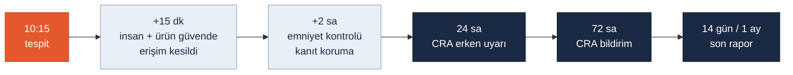

<!-- foy lab="6" title="CRA Incident Simulation" output="Incident Workflow" -->
<!-- pdf:skip-start -->
# Lab 6 · CRA Incident Simulation

**Makine:** Arminoks Süt Otomatı · **Çıktı:** Incident Workflow → Evidence Pack **EP 13 Incident Response** · 📄 [PDF föyü](../pdf/lab6-cra-incident-simulation.pdf)

| Ad Soyad | Öğrenci No | Grup | Tarih |
|---|---|---|---|
| Batuhan Yaşar Özkan | 230541050 | Gündüz-B | 06.11.2026 |
<!-- pdf:skip-end -->

> **Senaryo:** Saat 10:15. Servis hesabında yetkisiz erişim tespit edildi. PLC konfigürasyonu değişmiş olabilir. Makine hâlâ çalışıyor. Vardiya sorumlusu sizsiniz.

> **Kavram:** Bir olayda en değerli iki şey **zaman ve kanıttır**. CRA'nın 24s / 72s / 14 gün yükümlülükleri, iyi bir müdahale akışının doğal kilometre taşlarıdır — ezber değil.

> **Arminoks bağlamı:** "Makine hâlâ çalışıyor" bu otomatta şu anlama gelir: tank soğutuluyor, karıştırıcı programına göre dönüyor, müşteri gelirse dolum yapılıyor. Değişmiş olabilecek konfigürasyon sıcaklık eşiğini (SF-02), yıkama sırasını (SF-04) ya da kapak/reset mantığını (SF-01/SF-03) etkileyebilir. Servis hesabı ve kontrolör ders kabulüdür (V01, V07); olay masa başı bir eğitim senaryosudur, yaşanmış bir olay değildir.

## Görev — zaman çizgisini doldurun

### 1. 10:15 — ilk 15 dk: Kimi ararsınız? İlk üç eyleminiz?

**Ararım:** işletmenin bakım/OT sorumlusu, gıda güvenliği sorumlusu ve olay yöneticisi (önerilen roller; Arminoks çalışanı değil).

1. **İnsanı ve ürünü koru:** Satış ve dolumu tanımlı prosedürle askıya al, bakım alanına girişi engelle. Soğutmayı **kesme**; enerjiyi tamamen kesmek sütü bozar ve kanıtı (RAM'deki durum) siler.
2. **Erişimi kes, kanıtı bozmadan:** Şüpheli servis oturumunu sonlandır, hesabı askıya al, uzak erişim yolunu (C01) kapat. Reset, fabrika ayarı ve program yükleme **yapılmaz**.
3. **Yaz:** Tespit saati, kimin neyi gördüğü, panel durumu, bağımsız bir termometreyle tank sıcaklığı ve alınan kararlar. Saat kaynağı ve sapması not edilir.

### 2. İlk 2 saat: Emniyet güvende mi? Neyi korursunuz (kanıt!)? Hangi hesap kapatılır?

**Emniyet güvende mi?** Henüz söylenemez. Satış kapalı kalır; yetkili ekip kapak koruması, sıcaklık ölçümünün doğruluğu ve yıkama–satış ayrımını kontrol eder. 10:15'ten önceki satışlar gıda sorumlusunca ayrıca değerlendirilir; sıcaklık geçmişi bilinmiyorsa "güvenli" sayılmaz.

| Korunacak kanıt | Nasıl |
|---|---|
| Servis hesabı ve oturum kayıtları | Yetkili erişimle dışa alınır, silinmez |
| Kontrolör konfigürasyonu ve proje | Salt okunur kopya; bilinen iyi yedekle karşılaştırılır |
| Sıcaklık, alarm ve yıkama geçmişi | Tutuluyorsa korunur; yoksa "yok" diye yazılır, uydurulmaz |
| USB satış geçmişi | Orijinal korunur, kopya üzerinde çalışılır |
| Kanıt teslim kaydı | Kim, neyi, ne zaman, hangi yöntemle aldı; SHA-256 ve saklama yeri |

**Kapatılan hesap:** ihlalle ilişkili **servis hesabı** (askıya alınır, silinmez). Paylaşılan bir hesapsa aynı parolayı bilen herkes etkilenir; parola değişir ve kapsam yazılır. Diğer hesaplar körlemesine silinmez.

### 3. 24 saat — CRA erken uyarı: Hangi bilgi hazır olmalı?

- Olay kimliği; tespit ve farkına varma saatleri
- Ürün: Arminoks süt otomatı, bilinen model bilgisi (sürüm tahmin edilmez)
- Ne görüldü: servis hesabında yetkisiz erişim; olası konfigürasyon değişikliği
- Etki: insan, ürün (satışlar) ve işletme etkisi; alınan önlem (satış kapalı, erişim kesik)
- **Aktif istismar** şüphesi var mı; başka otomatları etkileyebilir mi
- Bilinmeyenler ve iletişim sorumlusu

CRA bildirimi **üreticinin** yükümlülüğüdür (ENISA ve yetkili CSIRT'e). Vardiya sorumlusu kendisi resmî bildirim göndermez; bilgiyi üreticiye ve işletme yönetimine hazırlar.

### 4. 72 saat — CRA bildirim: Kök neden, etki, önlem — kim ne yapıyor?

| Rol | 72 saate kadar yaptığı |
|---|---|
| Olay yöneticisi | Tek zaman çizgisi, kararlar ve görev dağılımı |
| Bakım/OT sorumlusu | Erişim yolu, konfigürasyon farkı, gerçek yazılım sürümleri; geçici kısıtları sürdürür |
| Gıda güvenliği sorumlusu | Etkilenen satış aralığı, sıcaklık/yıkama kayıtları, ürün kararı (geri çağırma gerekir mi) |
| Üretici / bildirim sorumlusu | Ürün kapsamı, kök neden analizi, düzeltme; CRA bildirimini yürütür |

Kök neden henüz bulunmadıysa "inceleme sürüyor" yazılır; **72 saatlik bildirim kesin kök neden beklenerek geciktirilmez**. Hesap kapatıldı diye otomat yeniden satışa açılmaz.

### 5. 14 gün — son rapor: Hangi loglar/kayıtlar korunmuş olmalı?

İlk uyarı; oturum ve hesap kayıtları; konfigürasyonun **önce/sonra** kopyaları ve hash'leri; kanıt teslim zinciri; sıcaklık, satış ve yıkama geçmişi; ürün kararları; değişiklik onayları; KT testlerinin sonuçları; geri dönüş planı ve yeniden işletme izni.

**CRA süre ayrımı (Madde 14):** Aktif istismar edilen bir **zafiyette** son rapor, düzeltici veya hafifletici önlem hazır olduktan sonra en geç **14 gün**; ciddi bir **olayda** ise 72 saatlik bildirimden sonra **1 ay** içinde verilir. Bildirim yükümlülükleri 11.09.2026'dan itibaren uygulanır. Hangisinin geçerli olduğu ürün kapsamı doğrulanınca belirlenir.

> **En sık hata:** "Resetleyip devam edelim" — o düğme, kanıtı sonsuza dek siler. Önce emniyet, hemen sonra kanıt. Bu otomatta ek bir tuzak daha var: "her şeyi kapatalım" — soğutma da kapanır, süt bozulur.

## Ek sorularımız

### 6. Soğutma sürerken kanıt nasıl korunur? `EK SORU`

Otomat kapatılmadan **salt okunur** yöntemle konfigürasyon ve kayıtlar alınır; yazma yapan hiçbir araç kurulmaz. Ekran fotoğraflanır, bağımsız termometreyle sıcaklık ölçülüp saatle yazılır. Kanıt almak için enerji kesmek gerekiyorsa önce sütün nasıl korunacağı (başka tanka aktarma veya imha kararı) gıda sorumlusuyla belirlenir.

### 7. USB satış geçmişi kanıt olarak ne kadar güvenilirdir? `EK SORU`

Sınırlıdır. Kayıt değiştirilmiş kontrolör tarafından yazıldıysa saldırgan onu da değiştirmiş olabilir. Değeri, **bağımsız kaynaklarla** (ödeme sistemi, kasa kayıtları, müşteri şikâyetleri) tutarlı olup olmadığına bakılarak ölçülür. Orijinal dosya hash'lenip saklanır, analiz kopya üzerinde yapılır.

### 8. Şüpheli bakım bilgisayarı ve USB belleklerle ne yapılır? `EK SORU`

Ağdan ayrılır ama kapatılmaz; kullanımı durdurulur ve kanıt olarak etiketlenir. Son 30 gün içinde otomata takılan USB bellekler toplanır. Temiz olduğu doğrulanmadan hiçbiri yeniden kullanılmaz; geri yükleme için **olaydan önceki, hash'i bilinen** yedek kullanılır.

### 9. Otomat yeniden satışa ne zaman açılır? `EK SORU`

Dört koşul birlikte sağlanınca: (1) konfigürasyon bilinen iyi sürüme döndü ve hash'i doğrulandı; (2) KT01–KT04 koruma testleri geçti; (3) tank temizlendi, sıcaklık bağımsız ölçümle doğrulandı ve gıda sorumlusu ürünü onayladı; (4) erişim yolu LAB2 Görev B'ye göre kapatıldı. Onay yazılı ve kayıtlı verilir.

## Varsayımlar

V01, V05 ve V07 kullanıldı ([Makine profili](00-makine-profili.md)). Kaynaklar: [CRA — Regulation (EU) 2024/2847](https://eur-lex.europa.eu/eli/reg/2024/2847/oj/eng) Madde 14 ve 71; [Avrupa Komisyonu — CRA raporlama](https://digital-strategy.ec.europa.eu/en/policies/cra-reporting) (erişim 06.11.2026). Gerçek olay olmadığından doldurulmuş log, olay numarası veya test sonucu sunulmadı.

> Bu föyün çıktısı **Incident Workflow** → Evidence Pack **EP 13 Incident Response** başlığına oturur. Durum: **Taslak**.
