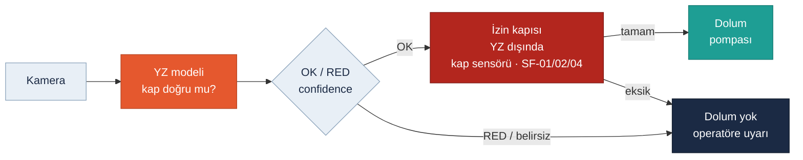

<!-- foy lab="7" title="AI Safety Challenge" output="AI Fail-Safe Decision" -->
<!-- pdf:skip-start -->
# Lab 7 · AI Safety Challenge

**Makine:** Arminoks Süt Otomatı · **Çıktı:** AI Fail-Safe Decision → Evidence Pack **EP 03 Safety Functions · EP 15 Verification/Test** · 📄 [PDF föyü](../pdf/lab7-ai-safety-challenge.pdf)

| Ad Soyad | Öğrenci No | Grup | Tarih |
|---|---|---|---|
| Batuhan Yaşar Özkan | 230541050 | Gündüz-B | 06.11.2026 |
<!-- pdf:skip-end -->

> **Kavram — Prediction ≠ Safety:** Yapay zekâ bir karar üretir; güvenliği garanti eden mimari **YZ'nin dışında** tanımlanmalıdır. Araçlar: **fail-safe · human override · monitoring · confidence threshold · fallback**.

> **Arminoks bağlamı:** Otomatta kamera, robot veya yapay zekâ olduğuna dair kanıt yok. Föyün zinciri (Kamera → YZ Modeli → OK / RED → Parametre → Robot) bu makineye **önerilen bir eğitim işlevi** olarak uyarlandı: kamera dolum ağzının altındaki kabı görür, model "kap doğru ve yerinde" derse doluma izin önerir. Robotun yerini **dolum pompası** alır. Föydeki "kusurlu parça" bu makinede **uygunsuz kap**tır (yanlış boyut, devrik, kirli veya hiç yok).

## Görev — üç başarısızlıkta güvenli davranış

Kırmızı **izin kapısı** YZ'nin dışındadır: model OK dese bile bağımsız kap sensörü, sıcaklık (SF-02), yıkama (SF-04) ve kapak (SF-01) koşulları sağlanmadan pompa çalışmaz. Föydeki zincir uyarlandı `UYARLANDI`.

### 1. Model yanlış sınıflandırdı: Kusurlu parçaya OK verdi. Sistem ne yapmalı? İkinci kontrol / insan onayı var mı?

Bu makinede: model **uygunsuz kaba** (devrik, yanlış boyut, kap yok) OK verdi.

- **İkinci kontrol olmalı (önerilen):** YZ'nin OK'u tek başına pompayı çalıştıramaz. İzin kapısına bağımsız bir kap/konum sensörü (ağırlık veya yakınlık) eklenmesi önerilir; broşürde böyle bir sensör yoktur. Sensör "kap yok" diyorsa dolum başlamaz. İki karar çelişirse **dolum yok** (fail-safe).
- **İnsan onayı:** Çelişkide operatör uyarılır; operatör kabı düzeltebilir ama sıcaklık, yıkama ve kapak kilitlerini **aşamaz**.
- **Kayıt:** Görüntü zamanı, model sürümü, YZ kararı ve sensör kararı saklanır; tekrarlayan yanlış OK'lar model gözden geçirmesini tetikler.

### 2. Girdi manipüle edildi: Kamera verisi bozuk/sahte. Nasıl fark edilir? Şüpheli girdide ne yapılır?

**Nasıl fark edilir (monitoring):** görüntünün zaman damgası eski veya sırası bozuk; akış donmuş ya da aynı kare tekrarlanıyor; görüntü kalitesi, ışık veya bulanıklık aniden değişti; kameranın gördüğü ile kap sensörü arasında tutarsızlık var. Bu işaretler sahteciliği **kesin** kanıtlamaz; gerçek algılama başarımı test edilmelidir.

**Ne yapılır:** Şüpheli girdide YZ kararı **kabul edilmez**, otomatik dolum bekletilir, operatöre ve bakım sorumlusuna olay bildirilir, görüntüler kanıt olarak saklanır. Kameranın arızası koruma işlevini devre dışı bırakamaz; soğutma sürer.

### 3. Confidence düştü: Model "emin değilim" diyor. Eşik ne olmalı? Altında: dur / insana sor / fallback?

**Eşik ne olmalı?** Gerçek kamera ve doğrulama verisi olmadan 0,90 ya da 0,95 gibi bir sayı **uydurulmaz**. Eşik; boş, devrik, yanlış boyutlu ve doğru kap örnekleri, farklı ışık koşulları ve bozuk görüntülerle kurulmuş bağımsız bir veri setinde, "yanlış OK oranı neredeyse sıfır" kabul ölçütüyle belirlenir. Confidence, emniyet güvenilirliği değildir; model veya kamera değişince eşik yeniden doğrulanır.

**Altında ne olur?** Sırasıyla: **dur** (dolum yok) → **insana sor** (operatör kabı görüp onaylar; temel kilitler yine geçerli) → **fallback** (YZ'siz, yalnız kap sensörüyle çalışan doğrulanmış manuel mod). Eşik doğrulanana kadar YZ'li otomatik dolum hiç devreye alınmaz.

## Karar tablosu — AI Fail-Safe Decision

| Başarısızlık | Tanımladığınız güvenli davranış (hangi kavramla?) |
|---|---|
| Model yanlış sınıflandırdı | YZ'nin OK'u tek başına yetmez; bağımsız kap sensörü onaylamazsa dolum yok, operatör uyarılır — **fail-safe + human override** (insan temel kilitleri aşamaz) |
| Girdi manipüle edildi | Eski, donmuş, tekrarlı veya sensörle çelişen görüntüde YZ kararı reddedilir, dolum bekler, olay kaydedilir — **monitoring + fail-safe** |
| Confidence düştü | Doğrulanmış eşiğin altında karar "belirsiz": dolum yok → operatör onayı → YZ'siz manuel mod — **confidence threshold + fallback** |

## Ek sorularımız

### 4. YZ kabı doğru buluyorsa süt de satılabilir mi? `EK SORU`

Hayır. Model yalnız **kabı** görür. Sütün sıcaklığı, tankın temizliği ve yıkamanın tamamlanması kameranın göremeyeceği şeylerdir; bunlar SF-02 ve SF-04 kilitlerinde kalır. YZ'nin kararı satış izninin **bir** girdisidir, tamamı değil.

### 5. Model güncellenince ne yapılır? `EK SORU`

Yeni model bir yazılım değişikliğidir (EP 14 Change Management). Önce aynı doğrulama veri setinde eski modelle karşılaştırılır; yanlış OK oranı artmışsa yüklenmez. Eşik yeniden doğrulanır, sürüm ve hash kaydedilir, eski modele geri dönüş yolu hazır tutulur. Güncelleme uzaktan değil, LAB4'teki süreli bakım prosedürüyle yapılır.

### 6. Operatör onayı neyi aşabilir, neyi aşamaz? `EK SORU`

**Aşabilir:** YZ'nin "emin değilim" ya da "RED" kararını, kabı kendisi görüp düzelttiğinde. **Aşamaz:** sıcaklık, yıkama ve kapak kilitlerini; bağımsız kap sensörünün "kap yok" kararını. Her operatör onayı kişisel hesapla kaydedilir; sık onay verilen durumlar modelin zayıf olduğu yeri gösterir.

### 7. YZ tamamen devre dışıyken otomat nasıl çalışır? `EK SORU`

Bugünkü otomat da kamerasız çalışıyor. YZ kapalıyken dolum, önerilen kap sensörü ve operatör kontrolüne döner. YZ kapalıyken otomatın **daha az güvenli değil, daha az otomatik** çalışması gerekir. Bu, YZ'nin emniyet zincirinin dışında tasarlandığının en basit testidir: kamera kablosu çekildiğinde güvenli davranış değişmemelidir (EP 15 doğrulama maddesi).

## Varsayımlar

Kamera ve YZ işlevi **yalnız eğitim senaryosudur**; otomatın envanterine eklenmedi ([Makine profili](00-makine-profili.md)). Model geliştirilmedi, confidence ölçülmedi, test yapılmadı. PLr/SIL atanmadı.

> Bu föyün çıktısı **AI Fail-Safe Decision** → Evidence Pack **EP 03 Safety Functions + EP 15 Verification/Test** başlığına oturur. Durum: **Taslak**.
